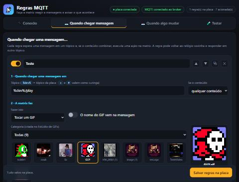

# WLED on ESP8266 (Wemos D1 R2): GIFs, a clock and MQTT rules

🇧🇷 [Leia em português](README.pt-BR.md)

A set of changes on top of [WLED](https://github.com/wled/WLED) (17.0.0-devV5, commit `356d5e7`) for a
**16x16 LED matrix driven by a Wemos D1 R2 (ESP8266, 4 MB flash, ~80 KB RAM)**.

WLED turns the Image/GIF effect off on the ESP8266 because the GIF decoder needs about 24 KB of RAM.
This project makes it work, trims the firmware to leave room, and adds three web tools and an MQTT
rules engine, all running on the board itself.

> Everything here was built and tested on a real board. It is a personal project, not an official WLED
> release. Parts of the code were written with AI assistance (marked `AI:` in the sources).

## Contents

- [What you get](#what-you-get)
- [What was changed, and why](#what-was-changed-and-why)
- [The web tools](#the-web-tools)
- [MQTT rules usermod](#mqtt-rules-usermod)
- [Build and install](#build-and-install)
- [Screenshots](#screenshots)
- [Limitations](#limitations)
- [Security notes](#security-notes)
- [Not done](#not-done)
- [Repository layout](#repository-layout)

## What you get

| Feature | Where |
|---|---|
| Image/GIF effect on the ESP8266 | firmware (`image_loader.cpp`, `lowram_libs/`) |
| Lean firmware (MQTT kept, Alexa/Hue/IR/Adalight/Loxone removed) | `platformio_override.ini` |
| Clock, date, weather, sensor, GIFs and effects as screens | tool **Relógio LED** |
| Several images to one GIF, sprite sheets, categories | tool **Estúdio de GIFs** |
| Rules: MQTT message → action on the matrix, state change → MQTT message | usermod `mqtt_rules` + tool **Regras MQTT** |

Firmware size on the D1 R2: flash 86.1 % (899,715 of 1,044,464 bytes), RAM 59.3 % at build time,
about 12 to 19 KB of free heap while running.

## What was changed, and why

### 1. Build configuration: `platformio_override.ini`

| Flag / setting | Why |
|---|---|
| `-D WLED_ENABLE_GIF` | turns the Image effect (fx 53) on |
| `-D GIF_LOW_RAM`, `-D GIF_CODE_LIMIT=576` | selects the reduced decoder (see 2) |
| `-D WLED_DISABLE_ALEXA`, `HUESYNC`, `INFRARED`, `ADALIGHT`, `LOXONE` | features not used here; they cost flash and RAM. **MQTT stays on** on purpose |
| `-D WLED_DISABLE_PARTICLESYSTEM2D` | saves flash; particle effects are not needed on 16x16 |
| `custom_usermods = mqtt_rules` | adds the rules engine |
| `lib_extra_dirs = lowram_libs` | uses the patched libraries instead of the registry ones |
| envs `d1_r2_gif_debug`, `_netdebug`, `_log` | serial log, UDP log, and `/giflog` for diagnosing the matrix when USB cannot be used |

### 2. Reduced GIF decoder: `lowram_libs/AnimatedGIF`

**Why:** the stock AnimatedGIF keeps a 4096-entry LZW dictionary plus a pixel stack, about 24 KB in a
single block. The ESP8266 has roughly 17 to 19 KB of heap when idle, so the allocation always failed
and the matrix stayed black.

**What:**
- The dictionary is now `GIF_CODE_LIMIT` entries (default **576**, about 7.3 KB). A frame of N pixels
  needs at most N + 258 codes, so 576 allows frames of up to **318 pixels** (16x16 and 32x8 fit).
  `1024` allows 766 pixels (32x16) at about 9 KB.
- Bounds checks were added so a frame that is too large fails cleanly instead of overflowing memory.
- `lowram_libs/GifDecoder` is a copy whose `library.properties` has `architectures=*`; the original
  declares only AVR and ESP32, and PlatformIO refused it on ESP8266.

### 3. Firmware changes: `wled00/`

| File | Change | Why |
|---|---|---|
| `image_loader.cpp` | Check the largest free heap block **before** allocating the decoder | ESP8266 builds have no C++ exceptions: a failed `new` would panic and reboot |
| `image_loader.cpp` | When memory is short, forget the name and retry every 500 ms, up to about 10 s (then report `ERR_NORAM_PX`) | the web UI uses RAM temporarily; the image should start by itself once memory is free |
| `image_loader.cpp` | Free the previous decoder before loading the next image | otherwise switching from one image to another failed until another effect was selected |
| `image_loader.cpp` | Reject frames larger than `GIF_CODE_LIMIT - 258` pixels with a clear error | the reduced dictionary cannot decode them |
| `image_loader.cpp` | Optional `GIF_LOG` ring buffer | the matrix draws too much current to keep USB connected, so logs are read over HTTP |
| `wled_server.cpp` | `GET /giflog` (only with `-D GIF_LOG`) | serves that log |
| `FX_fcn.cpp` | `Segment::setName` releases the decoder before replacing the name | WLED refuses allocations below `MIN_HEAP_SIZE` (9 KB) on ESP8266; with the decoder alive the new image name was silently ignored |
| `fcn_declare.h` | declaration of `gifLogText()` | support for the above |
| `data/pixelforge/pixelforge.htm` | removed the "not available on ESP8266" gate; the play request sends `ix:0` | the block came from page JavaScript; `ix` is blur and must be 0 for the Image effect on this CPU |

### 4. Settings made on the board (not in the code)

- **Colour order GRB** on the LED bus: red and green were swapped at first.
- **Time:** NTP server given as an **IP** (`200.160.0.8`), because the board could not resolve host names;
  time zone *Brasília*.
- Preset IDs used by the Clock tool: 201 to 205 (screens), 210 (cycle), 211 to 213 (sensor), 221 to 239
  (extra GIF/effect screens).

## The web tools

They are single HTML files stored on the board (gzip) and listed in PixelForge under *Other tools*
through `pftools.json`. Each one reads and writes the board through the normal WLED JSON API, so no
extra firmware is needed for them (except `mqtt_rules` for the rules tool).

### Relógio LED (`ferramentas/relogio`)
Turns the matrix into a clock.
- Layout editor: hours and minutes positions, **drag the numbers with the mouse** to place them.
- 12 h or 24 h, date formats (some, such as `24/11`, were added because they did not fit), fonts and sizes.
- Weather screen and a sensor screen (GPIO), transitions between screens.
- **GIFs and stock WLED effects as extra screens** (one or more, optional).
- Live preview using the **board's time**, not the PC's.
- Builds the presets and the playlist for you, and keeps backups of what it replaces.

### Estúdio de GIFs (`ferramentas/gifstudio`)
- Send several images and get one GIF; sprite sheets are cut into frames.
- Frame order, timing, resize to the matrix size.
- **Categories:** group GIFs by project, drag a GIF onto a category. Stored in `gifstudio.json`.

### Regras MQTT (`ferramentas/mqtt`)
Editor for the rules file used by the usermod. Tabs: Connection, Message → action, Event → message, Test.
- Actions: show text, play a GIF, show a WLED effect, apply a preset, set brightness, power, raw JSON command.
- **GIF picker with category filter and live preview** (uses the categories made in the GIF studio).
- **After the action:** go back to what was running before (the clock, a GIF, an effect); for text, **wait
  until it finishes scrolling**; or return to a fixed preset after N seconds.
- Optional MQTT reply, a *Test* tab that simulates a message without a broker, and a log of the last hits.
- **Time and weather rules** (tab *Por hora e clima*): fire at a time, every N minutes (optionally inside a time window)
  or when temperature/humidity changes, on the weekdays you tick. Optional condition (for example only if the
  temperature is above 28), an optional matrix action and an optional MQTT message that can include `{hm}`, `{dw}`, `{t}`, `{h}`.
- Temperature/humidity sources: a topic where a sensor publishes, or the weather of the city chosen in the Clock tool.
- Presets for public brokers with a warning, and a button that generates a unique topic.

## MQTT rules usermod

`usermods/mqtt_rules` keeps the rules in `/mqttrules.jsonl` (one JSON object per line, up to 760
characters, up to 10 subscribed topics). Rules are read from flash when needed, so they cost almost no RAM.
Rule format, placeholders (`%dev%`, `{p}`, `{n}`), the `b` (go back to previous) and `w` (wait for text)
flags, and the JSON API are described in [usermods/mqtt_rules/readme.md](usermods/mqtt_rules/readme.md).

How "go back to previous" works: before the first temporary action the usermod remembers the running
playlist or preset; when the action ends it re-applies that. "Wait for text" watches the Scrolling Text
effect's scroll offset and finishes when it wraps to zero, with a 3-minute safety limit.

Verified on the board: a long text returned after the full scroll (about 18 s instead of the 3 s timer),
a text that fits returned after the configured time, and the clock playlist was restored each time.

## Build and install

```powershell
git clone https://github.com/wled/WLED.git
cd WLED
git checkout 356d5e71c2107fac9475ff488c48d89ac2d382e9
git apply ..\wled-esp8266-matrix\patches\0001-wled-esp8266-gif.patch
Copy-Item -Recurse ..\wled-esp8266-matrix\lowram_libs .
Copy-Item -Recurse ..\wled-esp8266-matrix\usermods\mqtt_rules usermods\
Copy-Item ..\wled-esp8266-matrix\platformio_override.ini .
npm ci; npm run build
pio run -e d1_r2_gif
```

The `.bin` is written to `build_output/release/`. Flash with `pio run -e d1_r2_gif -t upload` (USB) or
open `http://BOARD-IP/update` (OTA).

Install the tools (gzip files) and register them:

```powershell
curl.exe -F "data=@ferramentas/relogio/relogio.htm.gz;filename=relogio.htm.gz"   http://BOARD-IP/upload
curl.exe -F "data=@ferramentas/gifstudio/gifstudio.htm.gz;filename=gifstudio.htm.gz" http://BOARD-IP/upload
curl.exe -F "data=@ferramentas/mqtt/mqttrules.htm.gz;filename=mqttrules.htm.gz"   http://BOARD-IP/upload
```

Then add an entry per tool (`id`, `name`, `file`, `desc`) to `pftools.json` on the board so it shows in
PixelForge. The pages also open directly at `http://BOARD-IP/relogio.htm`, `/gifstudio.htm`, `/mqttrules.htm`.
To change a tool, edit its `*.src.htm` and run its `build.py`.

Tips learned the hard way:
- OTA: close other browser tabs that point at the board and use `curl -H "Expect:"`.
- USB can drop out while the matrix is powered (current draw); power the matrix separately or use OTA.
- Use the `d1_r2_gif_log` build and read `http://BOARD-IP/giflog` to see what the GIF loader is doing.

## Screenshots

Rules tool with the GIF picker (category filter, thumbnails, big preview):



More screenshots (clock editor, GIF studio, PixelForge menu) can be added in `docs/img/`.

## Limitations

**GIF**
- Frames up to **318 pixels** with the default build (16x16, 32x8). Larger GIFs show an error. Raising
  `GIF_CODE_LIMIT` to 1024 allows 766 pixels (32x16) but uses about 2 KB more RAM.
- The Image effect needs `ix` (blur) at 0.
- Switching images can wait up to about 10 s if the heap is short (for example while many web pages are open).

**Memory**
- Free heap is about 12 to 19 KB. WLED refuses allocations below 9 KB, so keep few browser tabs open
  on the board and avoid very large presets or many segments.
- With MQTT on, large GIFs may not play while the web UI is busy.
- **While a GIF is playing, free heap is only about 9 KB** (about 17 KB when idle, 16.5 KB back after leaving the Image effect).
  WLED's heap guard acts when free heap stays below 8 KB: after 15 s it drops the effects, after 30 s it resets the
  segments, after 45 s it resets the strip and the connections. In practice the matrix goes dark and the web page stops
  answering. Measured costs: an open WebSocket about 0.6 KB, the live view (matrix preview) about 2.2 KB more.
  **Rule of thumb: while a GIF plays, keep only one browser tab open on the board and avoid the live preview**
  (PixelForge keeps it on). If you see a black matrix after choosing a GIF, close the other tabs; the image
  appears by itself when memory is available (up to about 10 s, longer if heap stays short).
  Recovery after a lock-up: power-cycle the board.
- Flash is at 86 %. Removing more features is the way to make room, not adding them.

**Network**
- No TLS on the ESP8266 with this build, so no `mqtts://` brokers (HiveMQ Cloud, most hosted services).
- The board cannot reliably resolve host names. Use **IPs** for the MQTT broker and the NTP server.
- Public brokers need a topic that nobody else uses.

**MQTT rules**
- 10 topics, 4 queued messages, 760 characters per rule, text up to 40 characters.
- Rules read the file on every message, so very high message rates are not a goal.
- Event rules cover preset changes, power and brightness only.
- "Wait for text" applies to the Scrolling Text effect on segment 0.
- The board has no temperature/humidity sensor. Values come from an MQTT topic or from the Clock tool's weather, which is
  only sent while the Clock tool page is open (and is lost on reboot). If both sources are used, the last one to write wins.
- Time rules work only after the board has the time (NTP) and use the time zone set on the board. Check that the time
  zone is the right one: a wrong zone shifts every rule.
- Value-triggered rules keep their "armed" state for the first 32 rules only; the log shows the last 6 events.

**Tools**
- Made for a single-segment 16x16 matrix. Other sizes work in principle but were not tested.
- PixelForge can rewrite `pftools.json` and drop the three custom entries; add them again if that happens.
- The boot preset is not set by the tools, so the clock does not start by itself after a reboot until you
  set a boot preset in the WLED settings.

## Security notes

- A public MQTT broker lets anyone who knows your topic send text to the matrix. Use the generated unique
  topic, keep tests short, and turn MQTT off afterwards. For real use, run your own broker (Mosquitto, Home Assistant)
  on the LAN and set a user and password.
- Never publish passwords or tokens you typed in tutorials or screenshots; rotate them if they leaked.
- The rules file can run any WLED JSON command. Only let trusted clients publish to the topics you subscribe to.

## Not done

- Raw-frame streaming redesign (a way to push pixel data directly).
- TLS for MQTT, DNS resolution fix.
- Automatic boot into the clock.

## Repository layout

```
patches/                 diff against WLED (commit in WLED_BASE_COMMIT.txt)
lowram_libs/             AnimatedGIF (reduced tables) and GifDecoder (all architectures)
usermods/mqtt_rules/     rules engine + readme
ferramentas/             relogio, gifstudio, mqtt tools (source, build script, gzip)
platformio_override.ini  build environments for the D1 R2
docs/img/                screenshots
```

WLED is MIT-licensed; AnimatedGIF is Apache-2.0. Check each upstream project's license before reusing code.
