# WLED on ESP8266 (Wemos D1 R2): GIFs, a clock and MQTT rules

🇧🇷 [Leia em português](README.pt-BR.md)

A set of changes on top of [WLED](https://github.com/wled/WLED) (17.0.0-devV5, commit `356d5e7`) for a
**16x16 LED matrix driven by a Wemos D1 R2 (ESP8266, 4 MB flash, ~80 KB RAM)**.

WLED turns the Image/GIF effect off on the ESP8266 because the GIF decoder needs about 24 KB of RAM.
This project makes it work, trims the firmware to leave room, and adds four web tools and an MQTT
rules engine, all running on the board itself.

> Everything here was built and tested on a real board. It is a personal project, not an official WLED
> release. Parts of the code were written with AI assistance (marked `AI:` in the sources). The web tools are
> written in Portuguese (Brazil).

## Contents

1. [What you get](#what-you-get)
2. [Quick start](#quick-start)
3. [What was changed, and why](#what-was-changed-and-why)
4. [The ESP8266 and its memory](#the-esp8266-and-its-memory) (charts)
5. [Tool 1: Relógio LED (clock)](#tool-1-relógio-led-clock)
6. [Tool 2: Estúdio de GIFs](#tool-2-estúdio-de-gifs)
7. [Tool 3: Regras MQTT (rules)](#tool-3-regras-mqtt-rules)
8. [Tool 4: Pixel Estúdio (pixel art, sprites, GIF, screen mirror)](#tool-4-pixel-estúdio-pixel-art-sprites-gif-and-screen-mirror)
9. [MQTT rules usermod](#mqtt-rules-usermod)
10. [Files and API used on the board](#files-and-api-used-on-the-board)
11. [Build and install](#build-and-install)
12. [Limitations](#limitations)
13. [Security notes](#security-notes)
14. [Not done](#not-done)
15. [Repository layout](#repository-layout)

## What you get

| Feature | Where |
|---|---|
| Image/GIF effect on the ESP8266 | firmware (`image_loader.cpp`, `lowram_libs/`) |
| Lean firmware (MQTT kept; Alexa, Hue, IR, Adalight, Loxone removed) | `platformio_override.ini` |
| Clock, date, weather, sensor, GIFs and effects as screens | tool **Relógio LED** |
| Several images to one GIF, sprite sheets, categories | tool **Estúdio de GIFs** |
| Pixel-art editor with frames, sprites, GIF export and **screen mirror** | tool **Pixel Estúdio** |
| MQTT: message → action on the matrix; state change → message; time/weekday/temperature/humidity rules | usermod `mqtt_rules` + tool **Regras MQTT** |

Firmware size on the D1 R2: flash 86.1 % (899,715 of 1,044,464 bytes), RAM 59.3 % static at build time,
about 17 KB of free heap when idle (see [memory](#the-esp8266-and-its-memory)).

## Quick start

1. Build and flash the firmware ([Build and install](#build-and-install)).
2. Open `http://BOARD-IP/` once, set the LED output (pin, 256 LEDs, colour order) and the 2D matrix size in the WLED settings.
3. Upload the four tool pages (gzip files in `ferramentas/`) and register them in `pftools.json`.
4. Open `http://BOARD-IP/relogio.htm` to build the clock, `/gifstudio.htm` to make GIFs, `/mqttrules.htm` to create MQTT rules, `/pixelstudio.htm` to draw, make sprites and mirror the screen.
5. **Keep a single browser tab open on the board while a GIF is playing** (see [memory](#the-esp8266-and-its-memory)).

## What was changed, and why

### 1. Build configuration: `platformio_override.ini`

| Flag / setting | Why |
|---|---|
| `-D WLED_ENABLE_GIF` | turns the Image effect (fx 53) on |
| `-D GIF_LOW_RAM`, `-D GIF_CODE_LIMIT=576` | selects the reduced decoder (see 2) |
| `-D WLED_DISABLE_ALEXA`, `HUESYNC`, `INFRARED`, `ADALIGHT`, `LOXONE` | features not used here; they cost flash and RAM. **MQTT stays on** on purpose |
| `-D WLED_DISABLE_PARTICLESYSTEM2D` | saves flash; particle effects are not needed on 16x16 |
| `custom_usermods = mqtt_rules` | adds the rules engine |
| `lib_extra_dirs = lowram_libs` | uses the patched libraries instead of the registry ones |
| envs `d1_r2_gif_debug`, `_netdebug`, `_log` | serial log, UDP log, and `/giflog` for diagnosing the matrix when USB cannot be used |

`WLED_DISABLE_ESPNOW` was tried and does not build: the project's post-link check requires the `wled-espnow` module to be present.

### 2. Reduced GIF decoder: `lowram_libs/AnimatedGIF`

**Why:** the stock AnimatedGIF keeps a 4096-entry LZW dictionary plus a pixel stack, about 24 KB in a
single block. The ESP8266 has roughly 17 KB of heap when idle, so the allocation always failed
and the matrix stayed black.

**What:**
- The dictionary is now `GIF_CODE_LIMIT` entries (default **576**, about 7.3 KB). A frame of N pixels
  needs at most N + 258 codes, so 576 allows frames of up to **318 pixels** (16x16 and 32x8 fit).
  `1024` allows 766 pixels (32x16) at about 9 KB.
- Bounds checks were added so a frame that is too large fails cleanly instead of overflowing memory.
- `lowram_libs/GifDecoder` is a copy whose `library.properties` has `architectures=*`; the original
  declares only AVR and ESP32, and PlatformIO refused it on ESP8266.

### 3. Firmware changes: `wled00/`

| File | Change | Why |
|---|---|---|
| `image_loader.cpp` | Check the largest free heap block **before** allocating the decoder | ESP8266 builds have no C++ exceptions: a failed `new` would panic and reboot |
| `image_loader.cpp` | When memory is short, forget the name and retry every 500 ms, up to about 10 s (then report `ERR_NORAM_PX`) | the web UI uses RAM temporarily; the image should start by itself once memory is free |
| `image_loader.cpp` | Free the previous decoder before loading the next image | otherwise switching from one image to another failed until another effect was selected |
| `image_loader.cpp` | Reject frames larger than `GIF_CODE_LIMIT - 258` pixels with a clear error | the reduced dictionary cannot decode them |
| `image_loader.cpp` | Optional `GIF_LOG` ring buffer | the matrix draws too much current to keep USB connected, so logs are read over HTTP |
| `wled_server.cpp` | `GET /giflog` (only with `-D GIF_LOG`) | serves that log |
| `FX_fcn.cpp` | `Segment::setName` releases the decoder before replacing the name | WLED refuses allocations below `MIN_HEAP_SIZE` (9 KB) on ESP8266; with the decoder alive the new image name was silently ignored |
| `fcn_declare.h` | declaration of `gifLogText()` | support for the above |
| `data/index.htm` | Four shortcut buttons (Clock, GIFs, Pixel Art, MQTT) next to PixelForge on the main page | one click from the WLED controls to the custom tools (the tools have a matching top bar) |
| `data/pixelforge/pixelforge.htm` | removed the "not available on ESP8266" gate; the play request sends `ix:0` | the block came from page JavaScript; `ix` is blur and must be 0 for the Image effect on this CPU |

### 4. Settings made on the board (not in the code)

- **Colour order GRB** on the LED bus: red and green were swapped at first.
- **Time:** NTP server given as an **IP** (`200.160.0.8`), because the board could not resolve host names. The time zone is whatever
  is chosen in the Clock tool or in the WLED settings (the clock follows the board's zone).
- Preset IDs used by the Clock tool: 201 hour, 202 date, 203 temperature, 204 humidity, 205 free text, 210 the cycle (playlist),
  211 to 213 sensor presets, 221 to 239 extra GIF/effect screens.

## The ESP8266 and its memory

The ESP8266 is a single-core 80 MHz chip with **about 80 KB of RAM**, WiFi included. It has no PSRAM, no hardware TLS,
and a small stack. Everything in this project is shaped by those limits.

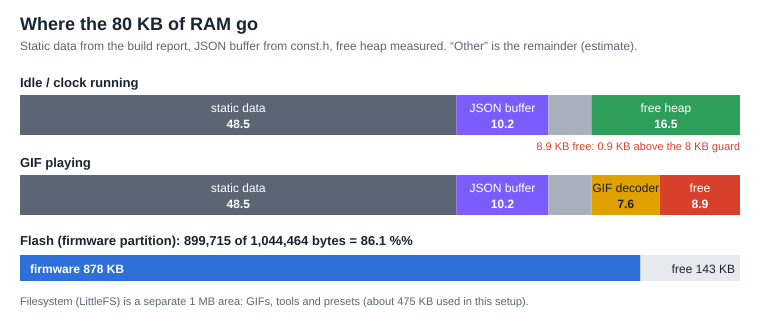

- **Static data (48.5 KB)** is what the firmware needs just to exist (from the PlatformIO build report).
- **JSON buffer (10.2 KB)**: WLED allocates one shared buffer for its API (`JSON_BUFFER_SIZE`, `const.h`). It was not
  shrunk: it also holds the configuration while saving, and the OTA code asserts a minimum size, so a smaller value risks losing settings.
- **Free heap** is what is left for everything dynamic: web server connections, WebSocket clients, MQTT, the effects, and
  the **GIF decoder (7.6 KB)**, which stays allocated for as long as a GIF plays. "Other" is the remainder (an estimate).
- The 1 MB firmware partition is 86 % full; the filesystem (LittleFS, 1 MB) holds GIFs, the tool pages and presets.

### What costs memory

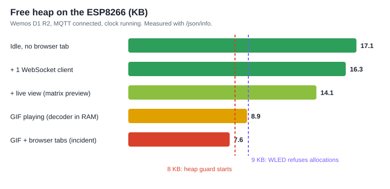

| Situation (measured on the board) | Free heap |
|---|---|
| Idle, clock running, MQTT connected, no browser tab | about 17.1 KB (stable for minutes: no leak) |
| One WebSocket client (any WLED page) | −0.6 KB |
| Live view (the matrix preview in the page) | −2.2 KB more, one client at a time |
| **A GIF playing** | **8.9 KB** (the decoder takes 7.6 KB) |
| Back to a normal effect or the clock | 16.5 KB again |

### The heap guard, and the incident

WLED watches the free heap. If it stays **below 8 KB (`MIN_HEAP_SIZE` 9 KB minus 1 KB)** for 15 s it removes the effects, after 30 s
it resets the segments, after 45 s it resets the whole strip and the connections (`wled.cpp`). With a GIF playing the board has only
0.9 KB of margin, so one or two extra browser tabs push it under the line:


What the user sees: after choosing a GIF the matrix stays black for a while (the loader waits for memory), then the matrix goes dark
and the web page stops answering. Closing tabs and power-cycling the board brings it back. It is not a leak: the memory returned to 16.5 KB as soon as
the GIF stopped.

**Rule of thumb: while a GIF is playing, keep only one browser tab open on the board and avoid the live preview** (PixelForge keeps it on).
The clock and normal effects do not have this problem.

### Other ESP8266 facts that shaped the project

| Topic | Fact | Consequence |
|---|---|---|
| TLS | no TLS support in this build | no `mqtts://` brokers; use a plain MQTT broker (a public one for tests) |
| DNS | host names are resolved unreliably | use the **IP** of the MQTT broker and of the NTP server |
| Exceptions | none: a failed `new` aborts and reboots | the GIF loader checks the heap before every allocation |
| Flash | 4 MB: ~1 MB firmware, ~1 MB filesystem, the rest for OTA staging and the system | firmware must stay under 1,044,464 bytes; disabled features pay for new ones |
| Power | a 16x16 matrix can draw several amperes at full white | powering from USB drops the connection and resets; use a proper 5 V supply (and lower the brightness / WLED current limit) |
| Pins | few usable GPIOs; the tools label them D1, D2… | the sensor tab hides pins already used by the LEDs and buttons |
| Clock | no RTC; time comes from NTP or from the browser | rules and the clock need the board to know the time (the *Board and time* tab shows it) |

## Tool 1: Relógio LED (clock)

`http://BOARD-IP/relogio.htm`. It turns the matrix into a clock and builds the presets and the playlist for you. A live preview
on the right shows what the matrix will show (using the **board's** time) and has **Send clock to the board** and **Stop the clock**
buttons. The header chips show the connection, the matrix size, the free memory and the board time.
Before replacing anything it keeps a backup of the previous presets and configuration on the board.

### Tab ⏱ Relógio (layout)

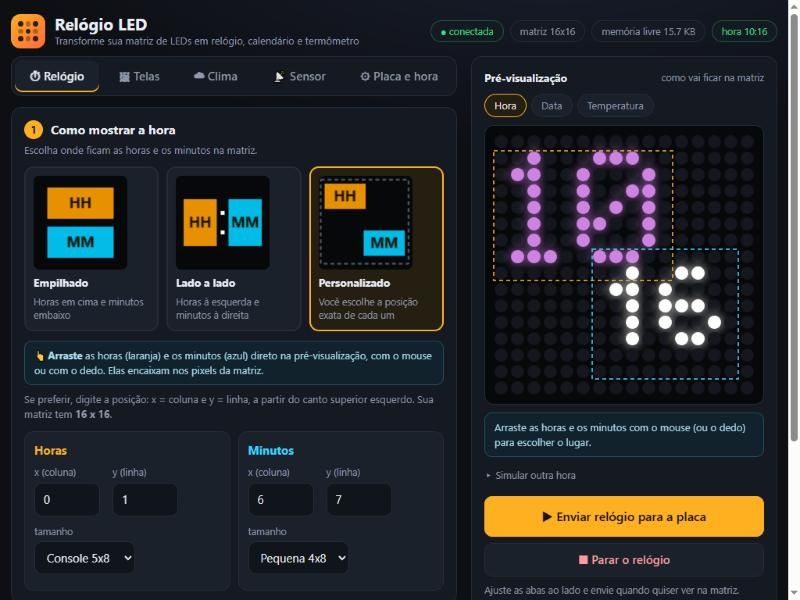

1. **How to show the time:** *Stacked* (hours above minutes), *Side by side*, or *Custom*, where **you drag the hours (orange) and
   the minutes (blue) with the mouse or a finger directly on the preview**; they snap to the matrix pixels. You can also type the
   x (column) and y (row) of each number.
2. **Number size:** a list of fonts (from *Mini 3x6* to *Tall 5x12*); the ones that do not fit the chosen layout are disabled.
   Switches for a leading zero (09 instead of 9) and for the ":" between hours and minutes.
3. **Colours and brightness:** one colour each for hours, minutes and ":", and the matrix brightness.

### Tab 🖼 Telas (screens)

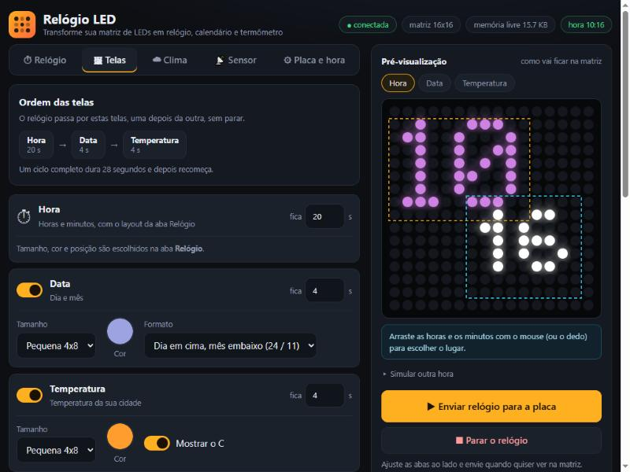

- **Order of the screens:** the clock goes through the screens one after the other, forever (a playlist). The summary shows each
  screen with its time and the total cycle length.
- Each screen has a switch, how long it stays on (seconds), font size and colour: **Hour** (uses the layout from the first tab),
  **Date** (formats such as `24 / 11`, weekday + day, weekday + DD/MM, or one line DD/MM), **Temperature** (with optional
  unit), **Humidity**, **Free text** (accepts the WLED tokens `#HH0 #MM0 #DAY #DD0 #MO0`).
- **Extra screens:** add **your GIFs** (from the board) and/or **stock WLED effects** (rainbow, fire, plasma…) to the cycle; each can be
  switched on or off, with its own duration. GIF screens switch without a soft blend to save memory, and the GIF must be at most 318 pixels
  per frame.
- **Transition:** instant, or a soft 3 s blend.

### Tab ☁ Clima (weather)

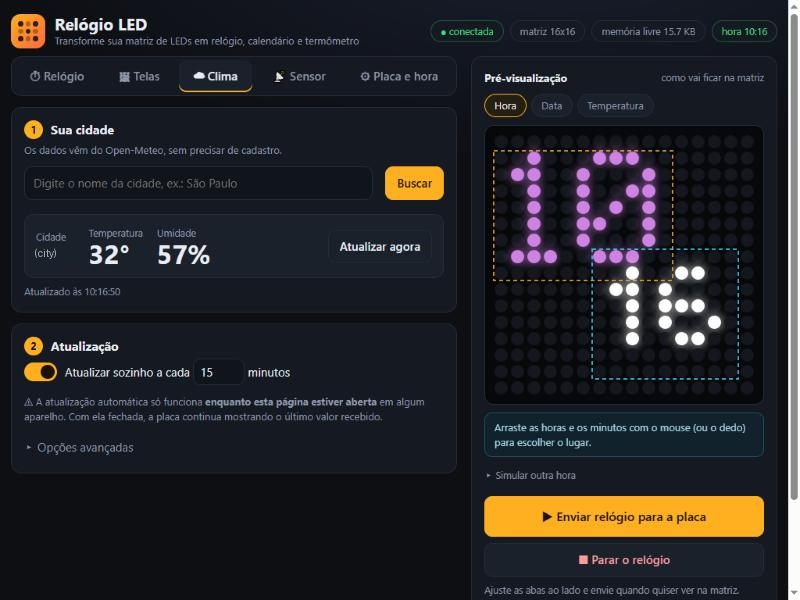

1. **Your city:** type a name and search; the data comes from [Open-Meteo](https://open-meteo.com/) (no account). The card shows the city,
   temperature and humidity, and an **Update now** button. (The city name was hidden in this screenshot.)
2. **Update:** automatic refresh every N minutes. **It only works while this page is open on some device**; with it closed the board keeps
   showing the last value. Advanced options: latitude, longitude, and the temperature symbol (`C`, `'C`, `c`).
- The values are also sent to the board for the MQTT rules (`{"mqttr":{"set":{"t":..,"h":..}}}`).
- The board has no sensor and cannot reach the internet by name, so the page does the download and hands the numbers to the board.

### Tab 📡 Sensor (button, motion, door)


Switch on **Use a sensor or button**, then:
1. **What did you connect?** Motion sensor (PIR), door/switch, button to GND (the usual one) or button to 3.3 V.
2. **Which pin?** A grid with the board's own labels (D1, D2…); pins already used by LEDs or buttons are disabled.
3. **What does the matrix do?** On activate, on deactivate, double click: *nothing*, *show the clock*, *show a message* (text, how long, size,
   colour) or *turn off*. Temperature sensors (DHT, DS18B20) need a firmware module and are not included.

It is saved from the **Board and time** tab (the board restarts once).

### Tab ⚙ Placa e hora (board and time)

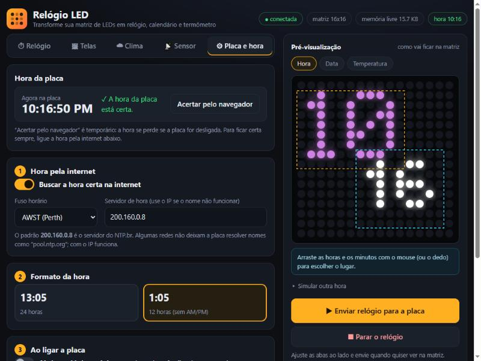

- **Board time:** shows the time the board has, says whether it is right, and **Set from browser** (temporary: lost when the board is powered off).
- **1 · Internet time:** switch for NTP, the **time zone** list and the **time server** (use the IP; `200.160.0.8` is the Brazilian NTP.br).
- **2 · Time format:** 24 h or 12 h.
- **3 · On power-up:** open the clock automatically (boot preset).
- **4 · Write to the board:** saves time, zone, format, boot behaviour and sensor to the board's configuration. **The board restarts once
  (about 10 s)** and a copy of the previous configuration is kept first.

## Tool 2: Estúdio de GIFs

`http://BOARD-IP/gifstudio.htm`. Builds GIFs in the browser and saves them to the board, organised in categories. The header shows the
matrix size and the filesystem use (files, KB).

### Tab 🎬 Criar GIF (create)

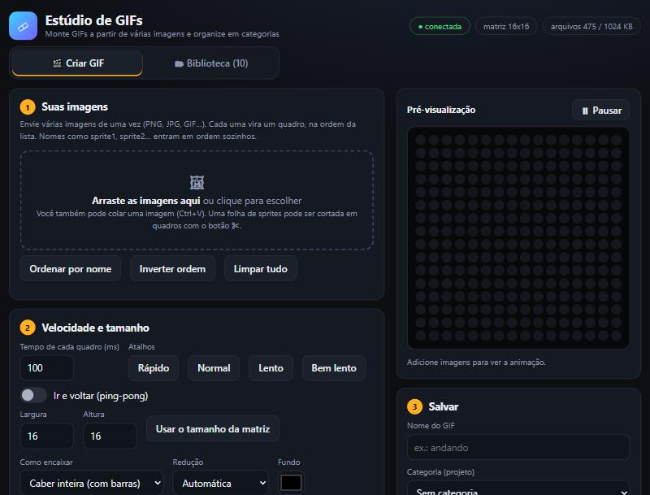

1. **Your images:** drop or pick several images at once (PNG, JPG, GIF…) or paste one (Ctrl+V). Each becomes a frame, in list order (you can **drag the frames to reorder them**); names
   such as `sprite1`, `sprite2`… sort themselves. Buttons: *Sort by name*, *Reverse order*, *Clear all*, and **✂ Cut sprite sheet**
   (columns, rows, skip empty frames) to turn one sheet into frames.
2. **Speed and size:** time per frame (ms, or the presets Fast / Normal / Slow / Very slow), *ping-pong* (forward and back), width and
   height (**Use the matrix size**), how to fit (*whole with bars*, *fill and crop*, *stretch*), downscale mode (*automatic*, *sharp* for pixel
   art, *smooth* for photos) and background colour. Any frame can have its own time in its "ms" box.
3. **Save:** GIF name, category, **Play on the matrix after saving**, **Generate and save to the board** or **Download to the computer**.
   A **live preview** (with Pause) shows the animation at the matrix size. A warning appears above 318 pixels per frame, the limit of the
   board's decoder.

### Tab 🗂 Biblioteca (library)

- A grid of the GIFs on the board with animated thumbnails, name, size and the category of each; a **search box** and a **sort** list (by name or by size).
- **Categories** on the side: *All*, *No category* and your own (name and colour, with counts). Create, rename or delete a category (its
  GIFs are not deleted, they move to "No category"). **Drag a GIF onto a category** to move it. Categories are
  stored in `gifstudio.json` and are also used by the MQTT tool's GIF picker.
- The menu of each GIF: **Rename**, **Download**, **Use in the clock** (adds it as an extra screen of the Clock tool), **Move to** a category (or a new one) and **Delete**.
- Multi-select to move or delete several GIFs at once, and **↻ Refresh**.
- (No screenshot: the library shows your own images.)

## Tool 3: Regras MQTT (rules)

`http://BOARD-IP/mqttrules.htm`. Writes the rules file used by the `mqtt_rules` usermod (see below). Header chips: board connected,
**MQTT connected to the broker**, and how many rules are on the board and how many fired. The bar at the bottom shows if there are unsaved
changes and has **Save rules to the board**. Rules are checked while you type (errors appear in that bar).

### Tab 🔌 Conexão (connection)

1. **What is this?** A short explanation of MQTT and brokers.
2. **Broker:** address (use the **IP**), port, user (if any), and the **name of this board on the broker** (client id). Shortcuts fill in a
   public broker (`broker.hivemq.com`, `test.mosquitto.org`); a **red warning** appears when a public broker is selected.
3. **Topic:** the board's base topic (`wled/...`); **Generate unique topic** creates a random one. A switch keeps (retains) status messages on the broker.
4. **Write to the board:** **Write connection and restart the board** (a backup of the old configuration is saved first).
   A note reminds that MQTT uses about 3 to 5 KB of the board's memory.

### Tab 📥 Quando chegar mensagem (message → action)

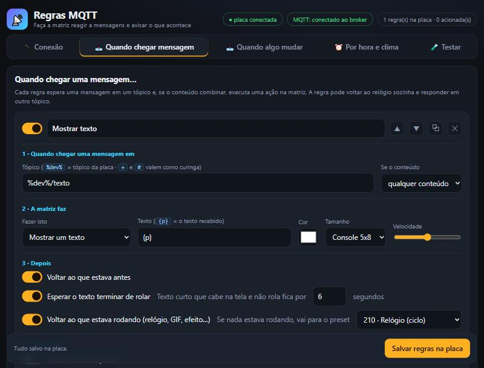

Each rule has an on/off switch, a name, and buttons to move, duplicate and delete it. Sections:
1. **When a message arrives on:** the topic (`%dev%` = the board's topic; `+` and `#` are wildcards) and a condition on the content: *any*, *equal to*,
   *contains*, *greater than*, *less than*, *between a,b*.
2. **The matrix does:** *Show a text* (`{p}` = the received text; colour, size, speed), *Play a GIF* (fixed, or the name comes in the message), *Show a WLED effect*
   (any 2D or strip effect with its own sliders, colours and palette), *Apply a preset* (fixed or the number comes in the message), *Set brightness*,
   *Turn on / off / toggle*, *JSON command* (advanced, with `{p}` and `{n}`), or *Nothing (only reply)*.
3. **Afterwards:** *Go back to what was before*, with two options: **wait for the text to finish scrolling** (a short text that fits the matrix stays for N
   seconds) and **go back to what was running** (clock, GIF or effect), with a fallback preset when nothing was running.
4. **Reply:** optionally publish a message (topic and content with `{p}`).

**GIF picker:** when the action is a GIF, a **category filter** (with counts) and a grid of **animated thumbnails** appear, plus a large **preview** of the
chosen GIF with its size and category:


The **✨ Ready-made examples** menu adds rules such as: show the received text, play a GIF by name, brightness over MQTT, turn on/off, apply a preset by number,
notify preset changes, notify on/off.

### Tab 📤 Quando algo mudar (state → message)

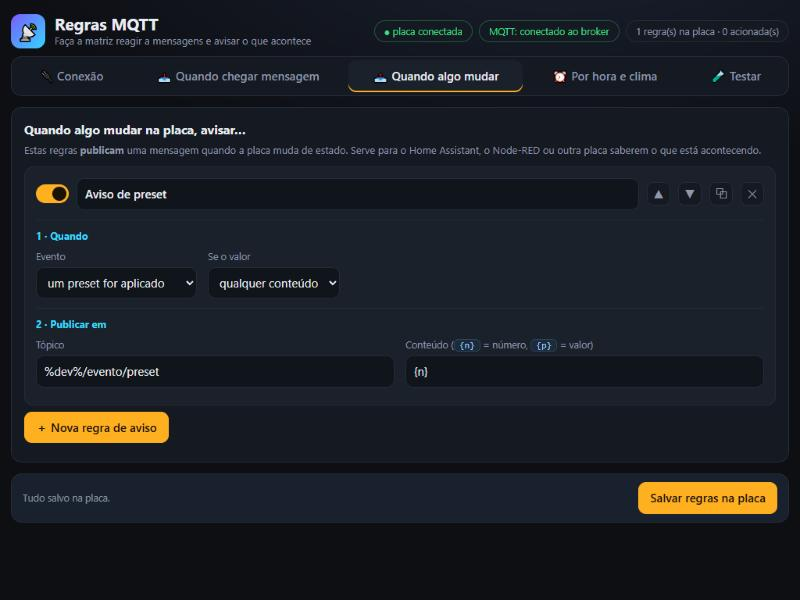

Rules that **publish** when the board changes state, so Home Assistant, Node-RED or another board know what is happening:
- **Event:** a preset is applied, the matrix turns on or off, or the brightness changes; optional condition on the value.
- **Publish on:** topic and content (`{n}` = number, `{p}` = on/off or value).

### Tab ⏰ Por hora e clima (time and weather)


**Where temperature and humidity come from.** The board has no sensor. Switch on a topic for each value (a sensor, for example another board with a DHT22, that
publishes a number), or use the weather of the city chosen in the Clock tool (only while that page is open). The line "Now on the board" shows the current values
and whether the time is known.

**Rules** fire:
- **At a time**, **every N minutes** (optionally only inside a time window, which may cross midnight) or **when temperature/humidity changes**;
- on the **weekdays** you tick (Sun to Sat);
- optionally **only if** the temperature or humidity is greater than / less than / equal to / between values;
- doing a **matrix action** (same actions as above, with the *go back* options) and/or **publishing an MQTT message** whose content may use `{hm}` (time),
  `{dw}` (weekday, 0 = Sunday), `{t}` (temperature) and `{h}` (humidity).


A rule triggered by a value fires when the condition becomes true and only fires again after it has turned false, so it does not repeat on every reading.

### Tab 🧪 Testar (test)

A test panel: send a **simulated message** (topic and content) to the board without any broker, and read the board's **log** of the last events (rules
fired, messages received, errors). It also shows the exact command to publish from another client. (No screenshot: it shows the device topic.)

## Tool 4: Pixel Estúdio (pixel art, sprites, GIF and screen mirror)

A pixel-art editor in the spirit of WLED's own *Pixel Paint*, but complete: it has **frames**, a **sprite library**, saves **GIFs** to the board and can
**mirror your computer screen** onto the matrix. Open `http://BOARD-IP/pixelstudio.htm`. The canvas starts at the matrix size (16x16) and can be changed (1 to 64).
Everything you draw is saved in the browser automatically, so a closed tab does not lose the work.

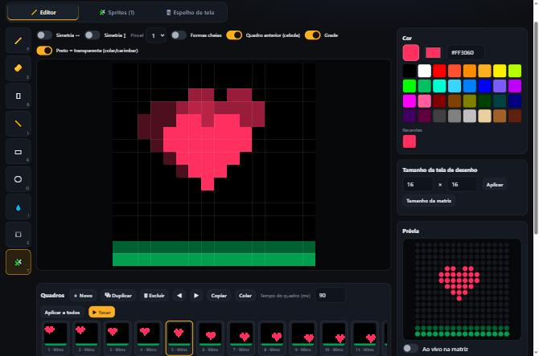

### Tab ✏️ Editor

- **Tools** (left bar, or the key in brackets): pencil `P`, eraser `E`, bucket `B` (Shift replaces every pixel of that colour), line `L`, rectangle `R`,
  ellipse `O`, eyedropper `I`, selection and move `S`, sprite stamp `T`. Right mouse button erases; Alt+click picks a colour.
- **Options**: brush 1 to 4 pixels, horizontal and vertical **symmetry**, filled shapes, **onion skin** (the previous frame in the background), grid,
  and "black = transparent" for paste and stamp.
- **Selection**: draw a rectangle, drag it to move (Ctrl while dragging copies), arrows nudge it, `Ctrl+C`, `Ctrl+X`, `Ctrl+V`, `Del`; `Enter` places it.
- **Colour**: colour picker, hex field, 32 ready colours and the 16 most recent ones.
- **Undo / redo**: `Ctrl+Z` / `Ctrl+Y`, 60 steps.
- **Frames** (timeline under the canvas): new, duplicate, delete, move (buttons or drag), copy and paste a frame, time of each frame in ms
  or one value for all, **play** with the preview (`Space`), optional ping-pong.
- **Current frame**: flip, turn 90° (square canvas only), invert colours, clear, shift with wrap-around; the switch "em todos os quadros" applies it to every frame.
- **Preview** in LED style, and **Ao vivo na matriz** (live): what you draw appears on the real matrix at once, and playing the animation plays it there too, with no
  file saved.
- **Save GIF**: name, "ping-pong", "play on the matrix afterwards" and **Gerar e salvar na placa** (it uploads the `.gif`, asks before replacing). Also **download the GIF**,
  **save the project** (`.pxs.json`) and **open / import**.
- **Import**: images (also pasted with `Ctrl+V`), animated GIFs (each frame becomes a frame) and sprite sheets (cut into frames or into sprites), and `.pxs.json` projects.
- A canvas larger than 318 pixels per frame (for example 20x20) is allowed, but the board cannot play such a GIF; the tool warns about it.

### Tab 🧩 Sprites


A sprite is a small drawing you reuse. Select an area in the editor and press **Salvar seleção como sprite** (or save the whole frame, or start a blank one).
The library keeps them in the browser; **Guardar sprites na placa** writes `pixelstudio-sprites.json` so another computer can fetch them, and the list can be exported as JSON.

- **Carimbar no editor** switches to the stamp tool: click to place the sprite, as many times as you like.
- **Editar** opens the sprite in a new frame; save it again with the same name to update it.
- Rename, duplicate, delete, flip, turn 90°.
- **Animar sprite (movimento)** builds frames of a sprite moving from one point to another: start and end X/Y, number of frames, time, easing (constant, accelerating,
  braking, smooth), background (the current frame or black), insert after the current frame or replace all, "wrap around the screen" and "come back" (there and back).
  The result is normal frames, ready to edit and save as a GIF.

### Tab 🖥 Espelho de tela (screen mirror)

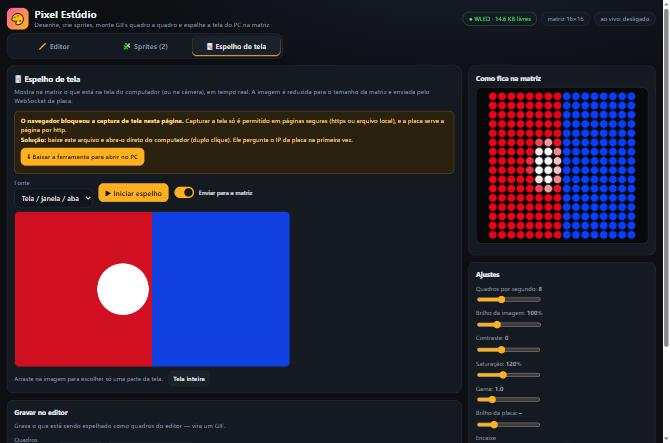

Shows what is on your computer screen (a whole screen, a window or a browser tab) or the camera on the matrix, in real time. The screenshot above shows the warning the
page gives when it is opened from the board, plus a synthetic test image.

- **How it works**: the browser captures the video, crops the part you chose (drag on the image; "Tela inteira" resets), fits it to the matrix size by averaging the
  pixels, applies the adjustments and sends only the pixels that changed over the WebSocket, in small messages (the ESP8266 accepts about 528 bytes per message).
  It waits for the board to answer before sending more.
- **Adjustments**: frames per second (1 to 20, default 8), image brightness, contrast, saturation, gamma, flip horizontal / vertical, fit (stretch, whole image, fill),
  and the **board brightness**.
- **Gravar no editor**: records N frames of the mirror as editor frames (so it becomes a GIF), or captures a single frame.
- **Starting and stopping**: the mirror takes over the whole matrix as one segment. When you stop, the tool puts the board back as it was (the previous segments, preset or
  playlist). If the clock was drawn by the Relógio LED page, it comes back when that page sends again.
- **Screen capture needs a secure page.** The board serves its pages over plain `http`, and browsers only allow screen capture on `https` or on a local file. So the page shows a
  button, **Baixar a ferramenta para abrir no PC**: save `pixelstudio.html`, double-click it, and type the board's IP the first time (or open it as `pixelstudio.html?ip=192.168.0.170`).
  Everything else (drawing, saving, live) works from either page.

### What was verified

- On the board: drawing tools, undo, selection, sprite creation, the movement generator (8 frames), GIF creation (the generated GIF was read back: 16x16, 8 frames), saving to the
  board and playing it.
- Live editing: the matrix showed exactly the pixels drawn in the editor (compared pixel by pixel through the live view).
- Mirror: tested with a synthetic video (red and blue halves and a moving white circle) in place of the screen. The matrix reproduced it at about 8 frames per second, with about 13.7 KB of
  free heap during the test, and stopping restored the two-segment clock layout.
- From another origin (`localhost` with `?ip=`) the page reached the board (info, WebSocket, upload and the GIF library), which is what the downloaded copy does.
- **Not verified**: capturing a real screen or window (the browser asks the person for permission, which a script cannot give), the camera source, the downloaded copy opened as a
  `file://` page, and touch screens.

## MQTT rules usermod

`usermods/mqtt_rules` keeps the rules in `/mqttrules.jsonl` (one JSON object per line, up to 760
characters, up to 10 subscribed topics). Rules are read from flash when needed, so they cost almost no RAM.
Rule format, placeholders (`%dev%`, `{p}`, `{n}`, `{t}`, `{h}`, `{hm}`, `{dw}`), the `b` (go back to previous) and `w` (wait for text)
flags, timed and value-source rules and the JSON API are described in [usermods/mqtt_rules/readme.md](usermods/mqtt_rules/readme.md).

How "go back to previous" works: before the first temporary action the usermod remembers the running
playlist or preset; when the action ends it re-applies that. "Wait for text" watches the Scrolling Text
effect's scroll offset and finishes when it wraps to zero, with a 3-minute safety limit.

Verified on the board: a long text returned after the full scroll (about 18 s instead of the 3 s timer),
a text that fits returned after the configured time, the clock playlist was restored each time, a time rule fired at the chosen minute and not on an excluded weekday,
conditions on temperature gated correctly, and value-triggered rules fired once per crossing.

## Files and API used on the board

| On the board (LittleFS) | What |
|---|---|
| `relogio.htm.gz`, `gifstudio.htm.gz`, `mqttrules.htm.gz`, `pixelstudio.htm.gz` | the four tool pages |
| `pftools.json` | the list shown in PixelForge → *Other tools* |
| `relogio-config.json` | state of the Clock tool |
| `relogio-cfg-backup.json`, `relogio-presets-backup.json`, `mqtt-cfg-backup.json` | backups made before the tools change the configuration |
| `gifstudio.json` | GIF categories and which category each GIF belongs to |
| `mqttrules.jsonl` | the rules the usermod runs |
| `mqttrules-ui.json` | the rules as shown in the tool (and the sensor topics) |
| `pixelstudio-sprites.json` | sprites saved from Pixel Estúdio (optional) |
| `*.gif` | your GIFs |

The tools only use the normal WLED API: `/json/state`, `/json/info`, `/json/effects`, `/json/fxdata`, `/json/palettes`, `/presets.json`,
`/cfg.json` (uploading it restores the configuration and reboots), `/edit?list=/`, `/edit?func=delete`, `/upload`, the WebSocket live view and, with
`GIF_LOG`, `/giflog`. The usermod adds the `mqttr` object to `/json/state` (`reload`, `test`, `set`) and to `/json/info`.

## Build and install

```powershell
git clone https://github.com/wled/WLED.git
cd WLED
git checkout 356d5e71c2107fac9475ff488c48d89ac2d382e9
git apply ..\wled-esp8266-matrix\patches\0001-wled-esp8266-gif.patch
Copy-Item -Recurse ..\wled-esp8266-matrix\lowram_libs .
Copy-Item -Recurse ..\wled-esp8266-matrix\usermods\mqtt_rules usermods\
Copy-Item ..\wled-esp8266-matrix\platformio_override.ini .
npm ci; npm run build
pio run -e d1_r2_gif
```

The `.bin` is written to `build_output/release/`. Flash with `pio run -e d1_r2_gif -t upload` (USB) or
open `http://BOARD-IP/update` (OTA).

Install the tools (gzip files) and register them:

```powershell
curl.exe -F "data=@ferramentas/relogio/relogio.htm.gz;filename=relogio.htm.gz"   http://BOARD-IP/upload
curl.exe -F "data=@ferramentas/gifstudio/gifstudio.htm.gz;filename=gifstudio.htm.gz" http://BOARD-IP/upload
curl.exe -F "data=@ferramentas/mqtt/mqttrules.htm.gz;filename=mqttrules.htm.gz"   http://BOARD-IP/upload
```

Then add an entry per tool (`id`, `name`, `file`, `desc`) to `pftools.json` on the board so it shows in
PixelForge. The pages also open directly at `http://BOARD-IP/relogio.htm`, `/gifstudio.htm`, `/mqttrules.htm`.
To change a tool, edit its `*.src.htm` and run its `build.py`.

Tips learned the hard way:
- OTA: close other browser tabs that point at the board and use `curl -H "Expect:"`. If the board answers ping but not HTTP after a flash, power-cycle it and check that the
  version really changed (the `mqttr` object in `/json/info` has the newest fields).
- USB can drop out while the matrix is powered (current draw); power the matrix separately or use OTA.
- Use the `d1_r2_gif_log` build and read `http://BOARD-IP/giflog` to see what the GIF loader is doing.
- Check the free heap with `http://BOARD-IP/json/info` (`freeheap`) while testing new features.

## Limitations

**GIF**
- Frames up to **318 pixels** with the default build (16x16, 32x8). Larger GIFs show an error. Raising
  `GIF_CODE_LIMIT` to 1024 allows 766 pixels (32x16) but uses about 2 KB more RAM.
- The Image effect needs `ix` (blur) at 0.
- Switching images can wait up to about 10 s if the heap is short (for example while many web pages are open).

**Memory**
- While a GIF plays, free heap is only about 9 KB: **keep one browser tab open** and avoid the live preview (see the [memory section](#the-esp8266-and-its-memory)).
- WLED refuses allocations below 9 KB, so avoid very large presets or many segments.
- With MQTT on, large GIFs may not play while the web UI is busy.
- Flash is at 86 %. Removing more features is the way to make room, not adding them.
- Recovery after a lock-up: power-cycle the board.

**Network**
- No TLS on the ESP8266 with this build, so no `mqtts://` brokers (HiveMQ Cloud, most hosted services).
- The board cannot reliably resolve host names. Use **IPs** for the MQTT broker and the NTP server.
- Public brokers need a topic that nobody else uses. A client such as MQTT Explorer must be connected to the **same broker** as the board and, on
  `broker.hivemq.com`, should subscribe to specific topics (for example `wled/<your-topic>/#`): a wildcard `#` on everything may deliver nothing.

**MQTT rules**
- 10 topics, 4 queued messages, 760 characters per rule, text up to 40 characters.
- Rules read the file on every message, so very high message rates are not a goal.
- Event rules cover preset changes, power and brightness only.
- "Wait for text" applies to the Scrolling Text effect on segment 0.
- The board has no temperature/humidity sensor. Values come from an MQTT topic or from the Clock tool's weather, which is
  only sent while the Clock tool page is open (and is lost on reboot). If both sources are used, the last one to write wins.
- Time rules work only after the board has the time (NTP) and use the time zone set on the board. A wrong zone shifts every rule.
- Value-triggered rules keep their "armed" state for the first 32 rules only; the log shows the last 6 events.

**Tools**
- Made for a single-segment 16x16 matrix. Other sizes work in principle but were not tested.
- PixelForge can rewrite `pftools.json` and drop the four custom entries; add them again if that happens.
- The tools do not set the boot preset unless you tick it in the *Board and time* tab, so the clock does not start by itself after a reboot until you
  set a boot preset.
- The interface is in Portuguese (Brazil).
- **Pixel Estúdio**: the live mode and the mirror use one WebSocket and take the whole matrix as one segment, so the free heap drops by about 1 to 3 KB while they run; keep one tab open.
- The mirror sends pixel by pixel through the JSON API, so it runs at about 8 frames per second (up to 20 is selectable, but the board may not keep up). It is not a video stream: for
  smooth video use a DDP/E1.31 sender, which a web page cannot do (no UDP).
- Screen capture only works from a secure page (see [the mirror tab](#tab--espelho-de-tela-screen-mirror)): download the page and open it from the computer.
- Sprites and the autosaved project live in the browser's storage (per browser and per address); use *Guardar sprites na placa* or *Salvar projeto* to move them.

## Security notes

- A public MQTT broker lets anyone who knows your topic send text to the matrix. Use the generated unique
  topic, keep tests short, and turn MQTT off afterwards. For real use, run your own broker (Mosquitto, Home Assistant)
  on the LAN and set a user and password.
- Never publish passwords or tokens you typed in tutorials or screenshots; rotate them if they leaked.
- The rules file can run any WLED JSON command. Only let trusted clients publish to the topics you subscribe to.
- Screenshots in this repository have the city name hidden; the device topic and broker settings are not shown.

## Not done

- Raw-frame streaming redesign (a way to push pixel data directly).
- TLS for MQTT, DNS resolution fix.
- Automatic boot into the clock.
- Real screen-capture and camera tests of the mirror (only a synthetic video was tried), and a smooth-video mode with DDP/E1.31.
- A smaller GIF decoder: a few hundred bytes could still be saved in the buffers, but not the 3 KB or more needed to let a GIF coexist with several browser tabs.

## Repository layout

```
patches/                 diff against WLED (commit in WLED_BASE_COMMIT.txt)
lowram_libs/             AnimatedGIF (reduced tables) and GifDecoder (all architectures)
usermods/mqtt_rules/     rules engine + readme
ferramentas/             relogio, gifstudio, mqtt, pixelstudio tools (source, build script, gzip)
platformio_override.ini  build environments for the D1 R2
docs/img/                screenshots and memory charts
```

WLED is MIT-licensed; AnimatedGIF is Apache-2.0. Check each upstream project's license before reusing code.
