# WLED no ESP8266 (Wemos D1 R2): GIFs, relógio e regras MQTT

🇬🇧 [Read in English](README.md)

Conjunto de mudanças sobre o [WLED](https://github.com/wled/WLED) (17.0.0-devV5, commit `356d5e7`) para uma
**matriz de LEDs 16x16 controlada por uma Wemos D1 R2 (ESP8266, 4 MB de flash, cerca de 80 KB de RAM)**.

O WLED desliga o efeito Imagem/GIF no ESP8266 porque o decodificador de GIF precisa de uns 24 KB de RAM.
Este projeto faz o efeito funcionar, enxuga o firmware para abrir espaço e acrescenta cinco ferramentas web
e um motor de regras MQTT, tudo rodando na própria placa.

> Tudo foi feito e testado em uma placa real. É um projeto pessoal, não uma versão oficial do WLED.
> Parte do código foi escrita com ajuda de IA (marcada com `AI:` nos fontes). As ferramentas web estão em português do Brasil.

## Índice

1. [O que você ganha](#o-que-você-ganha)
2. [Começo rápido](#começo-rápido)
3. [O que foi alterado e por quê](#o-que-foi-alterado-e-por-quê)
4. [O ESP8266 e a memória dele](#o-esp8266-e-a-memória-dele) (gráficos)
5. [Ferramenta 1: Relógio LED](#ferramenta-1-relógio-led)
6. [Ferramenta 2: Estúdio de GIFs](#ferramenta-2-estúdio-de-gifs)
7. [Ferramenta 3: Regras MQTT](#ferramenta-3-regras-mqtt)
8. [Ferramenta 4: Pixel Estúdio (pixel art, sprites, GIF, espelho de tela)](#ferramenta-4-pixel-estúdio-pixel-art-sprites-gif-e-espelho-de-tela)
9. [Ferramenta 5: Jogos na Matriz](#ferramenta-5-jogos-na-matriz)
10. [Usermod de regras MQTT](#usermod-de-regras-mqtt)
11. [Arquivos e API usados na placa](#arquivos-e-api-usados-na-placa)
12. [Compilar e instalar](#compilar-e-instalar)
13. [Limitações](#limitações)
14. [Segurança](#segurança)
15. [O que não foi feito](#o-que-não-foi-feito)
16. [Estrutura do repositório](#estrutura-do-repositório)

## O que você ganha

| Recurso | Onde |
|---|---|
| Efeito Imagem/GIF no ESP8266 | firmware (`image_loader.cpp`, `lowram_libs/`) |
| Firmware enxuto (MQTT mantido; Alexa, Hue, infravermelho, Adalight e Loxone removidos) | `platformio_override.ini` |
| Relógio, data, clima, sensor, GIFs e efeitos como telas | ferramenta **Relógio LED** |
| Várias imagens em um GIF, sprite sheets, categorias | ferramenta **Estúdio de GIFs** |
| Editor de pixel art com quadros, sprites, exportação de GIF e **espelho de tela** | ferramenta **Pixel Estúdio** |
| Dez jogos para PC e celular, 1 ou 2 jogadores | ferramenta **Jogos na Matriz** |
| MQTT: mensagem → ação na matriz; mudança de estado → mensagem; regras por hora, dia da semana, temperatura e umidade | usermod `mqtt_rules` + ferramenta **Regras MQTT** |

Tamanho do firmware na D1 R2: flash 86,1 % (899.715 de 1.044.464 bytes), RAM 59,3 % estática na compilação e
cerca de 17 KB de heap livre parada (veja a [memória](#o-esp8266-e-a-memória-dele)).

## Começo rápido

1. Compile e grave o firmware ([Compilar e instalar](#compilar-e-instalar)).
2. Abra `http://IP-DA-PLACA/` uma vez e configure a saída dos LEDs (pino, 256 LEDs, ordem de cores) e o tamanho da matriz 2D nas configurações do WLED.
3. Envie as cinco páginas das ferramentas (arquivos gzip em `ferramentas/`) e registre-as no `pftools.json`.
4. Abra `http://IP-DA-PLACA/relogio.htm` para montar o relógio, `/gifstudio.htm` para criar GIFs e `/mqttrules.htm` para criar regras MQTT e `/pixelstudio.htm` para desenhar, criar sprites e espelhar a tela.
5. **Mantenha uma única aba do navegador aberta na placa enquanto um GIF toca** (veja a [memória](#o-esp8266-e-a-memória-dele)).

## O que foi alterado e por quê

### 1. Configuração de compilação: `platformio_override.ini`

| Opção | Por quê |
|---|---|
| `-D WLED_ENABLE_GIF` | liga o efeito Imagem (fx 53) |
| `-D GIF_LOW_RAM`, `-D GIF_CODE_LIMIT=576` | escolhe o decodificador reduzido (veja o item 2) |
| `-D WLED_DISABLE_ALEXA`, `HUESYNC`, `INFRARED`, `ADALIGHT`, `LOXONE` | recursos que não uso; gastam flash e RAM. O **MQTT continua ligado** de propósito |
| `-D WLED_DISABLE_PARTICLESYSTEM2D` | economiza flash; efeitos de partículas não fazem falta em 16x16 |
| `custom_usermods = mqtt_rules game_relay` | inclui o motor de regras e o repasse de mensagens usado nos jogos em dois aparelhos |
| `lib_extra_dirs = lowram_libs` | usa as bibliotecas modificadas no lugar das do registro |
| ambientes `d1_r2_gif_debug`, `_netdebug`, `_log` | log pela serial, log por UDP e `/giflog`, para diagnosticar a matriz quando o USB não pode ficar ligado |

O `WLED_DISABLE_ESPNOW` foi testado e não compila: a verificação pós-link do projeto exige que o módulo `wled-espnow` esteja presente.

### 2. Decodificador de GIF reduzido: `lowram_libs/AnimatedGIF`

**Por quê:** a AnimatedGIF original mantém um dicionário LZW de 4096 entradas mais uma pilha de pixels,
cerca de 24 KB em um único bloco. O ESP8266 tem uns 17 KB de heap quando está parado, então a
alocação sempre falhava e a matriz ficava preta.

**O que mudou:**
- O dicionário agora tem `GIF_CODE_LIMIT` entradas (padrão **576**, cerca de 7,3 KB). Um quadro de N pixels
  precisa de no máximo N + 258 códigos, então 576 permite quadros de até **318 pixels** (16x16 e 32x8 cabem).
  Com `1024` cabem 766 pixels (32x16), usando uns 9 KB.
- Foram adicionadas verificações de limites para que um quadro grande demais falhe de forma limpa em vez de
  estourar a memória.
- `lowram_libs/GifDecoder` é uma cópia cujo `library.properties` tem `architectures=*`; o original declara só
  AVR e ESP32 e o PlatformIO o recusava no ESP8266.

### 3. Mudanças no firmware: `wled00/`

| Arquivo | Mudança | Por quê |
|---|---|---|
| `image_loader.cpp` | Verifica o maior bloco livre do heap **antes** de alocar o decodificador | no ESP8266 não há exceções C++: um `new` que falha derrubaria e reiniciaria a placa |
| `image_loader.cpp` | Se a memória estiver curta, esquece o nome e tenta de novo a cada 500 ms, por até uns 10 s (depois reporta `ERR_NORAM_PX`) | o painel web usa RAM temporariamente; a imagem deve começar sozinha quando houver memória |
| `image_loader.cpp` | Libera o decodificador anterior antes de carregar a próxima imagem | senão, trocar de uma imagem para outra falhava até escolher outro efeito |
| `image_loader.cpp` | Recusa quadros maiores que `GIF_CODE_LIMIT - 258` pixels com erro claro | o dicionário reduzido não consegue decodificá-los |
| `image_loader.cpp` | Buffer circular opcional `GIF_LOG` | a matriz consome muita corrente e o USB cai; por isso o log é lido por HTTP |
| `wled_server.cpp` | `GET /giflog` (só com `-D GIF_LOG`) | serve esse log |
| `FX_fcn.cpp` | `Segment::setName` libera o decodificador antes de trocar o nome | o WLED recusa alocações abaixo de `MIN_HEAP_SIZE` (9 KB) no ESP8266; com o decodificador vivo, o nome da nova imagem era ignorado em silêncio |
| `fcn_declare.h` | declaração de `gifLogText()` | apoio ao item acima |
| `data/index.htm` | Quatro botões de atalho (Clock, GIFs, Pixel Art, MQTT) ao lado do PixelForge na página principal | um clique dos controles do WLED até as ferramentas (as ferramentas têm a barra equivalente no topo) |
| `data/pixelforge/pixelforge.htm` | removida a trava "não disponível no ESP8266"; o pedido de reprodução envia `ix:0` | o bloqueio vinha do JavaScript da página; `ix` é o blur e precisa ser 0 no efeito Imagem nesta CPU |

### 4. Ajustes feitos na placa (não estão no código)

- **Ordem de cores GRB** no barramento de LEDs: no começo vermelho e verde estavam trocados.
- **Hora:** servidor NTP informado por **IP** (`200.160.0.8`), porque a placa não resolvia nomes. O fuso é o que for escolhido na
  ferramenta de relógio ou nas configurações do WLED (o relógio segue o fuso da placa).
- IDs de preset usados pela ferramenta de relógio: 201 hora, 202 data, 203 temperatura, 204 umidade, 205 texto livre, 210 o ciclo (playlist),
  211 a 213 presets do sensor, 221 a 239 telas extras de GIF/efeito.

## O ESP8266 e a memória dele

O ESP8266 é um chip de um núcleo a 80 MHz com **cerca de 80 KB de RAM**, já contando o WiFi. Não tem PSRAM, nem TLS por hardware,
e a pilha é pequena. Tudo neste projeto é moldado por esses limites.

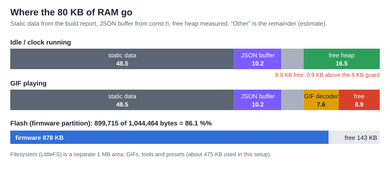

- **Dados estáticos (48,5 KB)** é o que o firmware precisa só para existir (do relatório de compilação do PlatformIO).
- **Buffer JSON (10,2 KB):** o WLED aloca um buffer compartilhado para a API (`JSON_BUFFER_SIZE`, `const.h`). Ele não foi
  reduzido: também guarda a configuração na hora de salvar, e o código de OTA exige um tamanho mínimo, então um valor menor arrisca perder configurações.
- **Heap livre** é o que sobra para tudo que é dinâmico: conexões do servidor web, clientes WebSocket, MQTT, os efeitos e
  o **decodificador de GIF (7,6 KB)**, que fica alocado enquanto um GIF toca. "Outros" é o resto (uma estimativa).
- A partição de 1 MB do firmware está 86 % cheia; o sistema de arquivos (LittleFS, 1 MB) guarda GIFs, as páginas das ferramentas e os presets.

### O que gasta memória

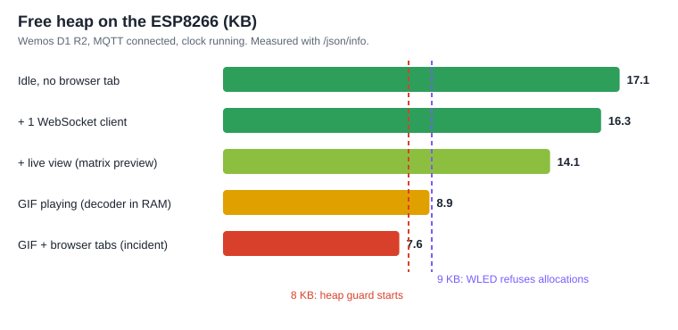

| Situação (medida na placa) | Heap livre |
|---|---|
| Parada, relógio rodando, MQTT conectado, sem aba aberta | cerca de 17,1 KB (estável por minutos: não há vazamento) |
| Um cliente WebSocket (qualquer página do WLED) | −0,6 KB |
| Live view (a pré-visualização da matriz na página) | −2,2 KB a mais, um cliente por vez |
| **Um GIF tocando** | **8,9 KB** (o decodificador usa 7,6 KB) |
| De volta a um efeito normal ou ao relógio | 16,5 KB de novo |

### A proteção de memória e o incidente

O WLED vigia o heap livre. Se ele ficar **abaixo de 8 KB (`MIN_HEAP_SIZE` de 9 KB menos 1 KB)** por 15 s, tira os efeitos; aos 30 s
reinicia os segmentos; aos 45 s reinicia a tira toda e as conexões (`wled.cpp`). Com um GIF tocando a placa tem só
0,9 KB de folga, então uma ou duas abas a mais do navegador a empurram para baixo da linha:

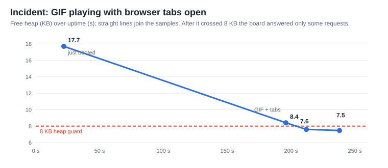

O que o usuário vê: depois de escolher um GIF, a matriz fica preta por um tempo (o carregador espera memória), depois a matriz apaga
e a página para de responder. Fechar as abas e desligar e ligar a placa resolve. Não é vazamento: a memória voltou a 16,5 KB assim que
o GIF parou.

**Regra prática: enquanto um GIF toca, mantenha só uma aba do navegador aberta na placa e evite a pré-visualização ao vivo** (o PixelForge a mantém ligada).
O relógio e os efeitos normais não têm esse problema.

### Outros fatos do ESP8266 que moldaram o projeto

| Assunto | Fato | Consequência |
|---|---|---|
| TLS | sem suporte a TLS neste build | sem brokers `mqtts://`; use um broker MQTT simples (um público para testes) |
| DNS | nomes de host são resolvidos de forma pouco confiável | use o **IP** do broker MQTT e do servidor NTP |
| Exceções | não existem: um `new` que falha aborta e reinicia | o carregador de GIF verifica o heap antes de cada alocação |
| Flash | 4 MB: ~1 MB de firmware, ~1 MB de sistema de arquivos, o resto para o OTA e o sistema | o firmware precisa ficar abaixo de 1.044.464 bytes; recursos desligados pagam os novos |
| Energia | uma matriz 16x16 pode puxar vários ampères no branco total | alimentar pelo USB derruba a conexão e reinicia; use uma fonte de 5 V adequada (e reduza o brilho / o limite de corrente do WLED) |
| Pinos | poucos GPIOs utilizáveis; as ferramentas os mostram como D1, D2… | a aba do sensor esconde os pinos já usados por LEDs e botões |
| Relógio | sem RTC; a hora vem do NTP ou do navegador | as regras e o relógio precisam que a placa saiba a hora (a aba *Placa e hora* mostra) |

## Ferramenta 1: Relógio LED

`http://IP-DA-PLACA/relogio.htm`. Transforma a matriz em relógio e cria os presets e a playlist para você. Uma pré-visualização ao vivo
à direita mostra o que a matriz vai exibir (usando a hora **da placa**) e tem os botões **Enviar relógio para a placa** e **Parar o relógio**.
Os chips do topo mostram a conexão, o tamanho da matriz, a memória livre e a hora da placa.
Antes de substituir qualquer coisa, a ferramenta guarda na placa um backup dos presets e da configuração anteriores.

### Aba ⏱ Relógio (layout)

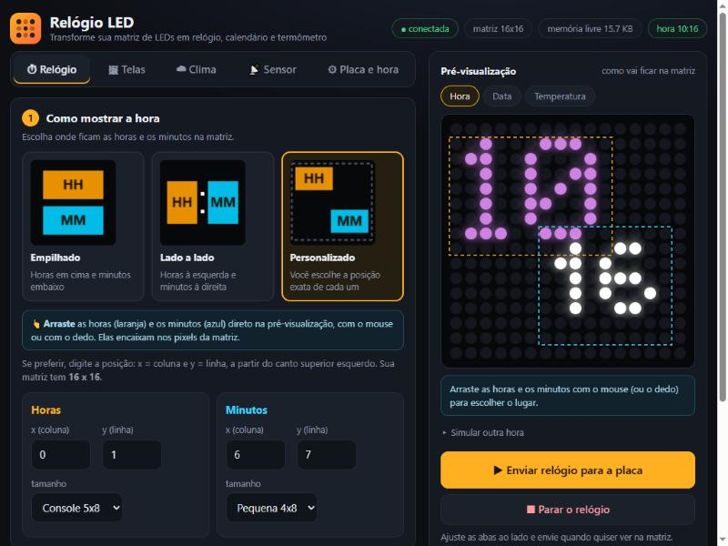

1. **Como mostrar a hora:** *Empilhado* (horas em cima e minutos embaixo), *Lado a lado* ou *Personalizado*, onde **você arrasta as horas (laranja) e
   os minutos (azul) com o mouse ou o dedo direto na pré-visualização**; eles encaixam nos pixels da matriz. Também dá para digitar
   x (coluna) e y (linha) de cada número.
2. **Tamanho dos números:** uma lista de fontes (de *Mini 3x6* a *Alta 5x12*); as que não cabem no layout escolhido ficam desativadas.
   Chaves para o zero na hora (09 em vez de 9) e para o ":" entre horas e minutos.
3. **Cores e brilho:** uma cor para as horas, uma para os minutos e uma para o ":", e o brilho da matriz.

### Aba 🖼 Telas

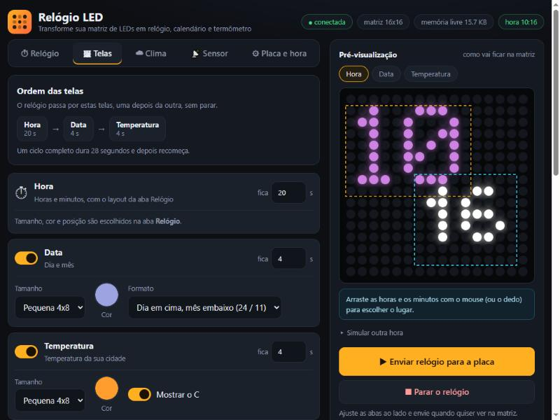

- **Ordem das telas:** o relógio passa pelas telas uma depois da outra, sem parar (uma playlist). O resumo mostra cada
  tela com o tempo e a duração total do ciclo.
- Cada tela tem uma chave, quanto tempo fica (segundos), tamanho da fonte e cor: **Hora** (usa o layout da primeira aba),
  **Data** (formatos como `24 / 11`, dia da semana e dia, dia da semana e DD/MM, ou uma linha DD/MM), **Temperatura** (com
  unidade opcional), **Umidade**, **Texto livre** (aceita os tokens do WLED `#HH0 #MM0 #DAY #DD0 #MO0`).
- **Telas extras:** coloque **seus GIFs** (da placa) e/ou **efeitos prontos do WLED** (arco-íris, fogo, plasma…) no ciclo; cada um pode ser ligado ou
  desligado, com duração própria. Telas com GIF trocam sem mistura suave para poupar memória, e o GIF precisa ter até 318 pixels
  por quadro.
- **Transição:** instantânea ou mistura suave de 3 s.

### Aba ☁ Clima

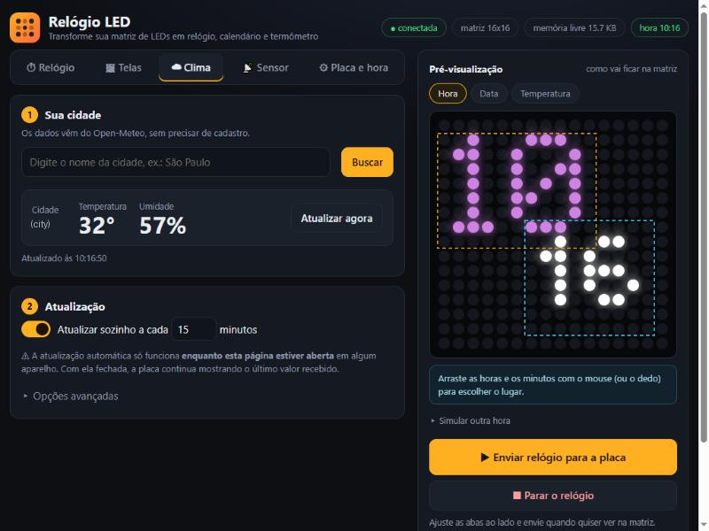

1. **Sua cidade:** digite um nome e busque; os dados vêm do [Open-Meteo](https://open-meteo.com/) (sem cadastro). O cartão mostra a cidade,
   a temperatura e a umidade, e o botão **Atualizar agora**. (O nome da cidade foi escondido neste print.)
2. **Atualização:** atualização automática a cada N minutos. **Só funciona enquanto esta página estiver aberta em algum aparelho**; com ela fechada a placa
   continua mostrando o último valor. Opções avançadas: latitude, longitude e o símbolo da temperatura (`C`, `'C`, `c`).
- Os valores também são enviados à placa para as regras MQTT (`{"mqttr":{"set":{"t":..,"h":..}}}`).
- A placa não tem sensor e não alcança a internet por nome, então a página faz o download e entrega os números à placa.

### Aba 📡 Sensor (botão, movimento, porta)

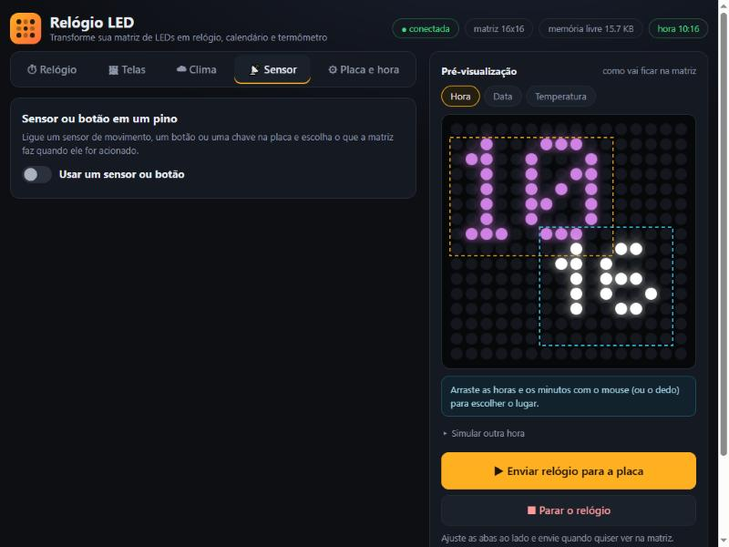

Ligue **Usar um sensor ou botão** e depois:
1. **O que você ligou?** Sensor de movimento (PIR), porta ou chave, botão para o GND (o mais comum) ou botão para 3,3 V.
2. **Em que pino?** Uma grade com as etiquetas da própria placa (D1, D2…); pinos já usados por LEDs ou botões ficam desativados.
3. **O que a matriz faz?** Ao ativar, ao desativar e no clique duplo: *nada*, *mostrar o relógio*, *mostrar uma mensagem* (texto, quanto tempo, tamanho,
   cor) ou *apagar*. Sensores de temperatura (DHT, DS18B20) precisam de um módulo no firmware e não estão incluídos.

É gravado pela aba **Placa e hora** (a placa reinicia uma vez).

### Aba ⚙ Placa e hora

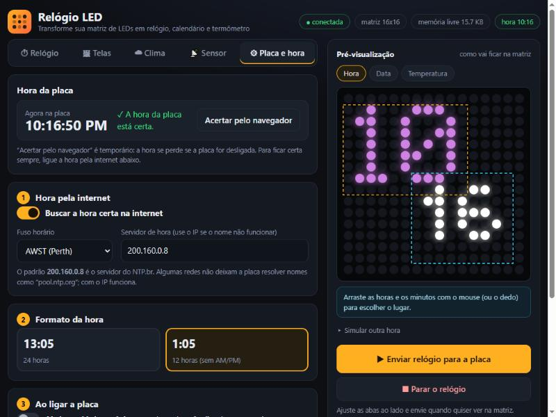

- **Hora da placa:** mostra a hora que a placa tem, diz se está certa e tem **Acertar pelo navegador** (temporário: se perde quando a placa é desligada).
- **1 · Hora pela internet:** chave do NTP, lista de **fusos horários** e **servidor de hora** (use o IP; `200.160.0.8` é o NTP.br).
- **2 · Formato da hora:** 24 h ou 12 h.
- **3 · Ao ligar a placa:** abrir o relógio sozinho (preset de boot).
- **4 · Gravar na placa:** grava hora, fuso, formato, comportamento ao ligar e sensor na configuração da placa. **A placa reinicia uma vez
  (uns 10 s)** e uma cópia da configuração anterior é guardada antes.

## Ferramenta 2: Estúdio de GIFs

`http://IP-DA-PLACA/gifstudio.htm`. Cria GIFs no navegador e os salva na placa, organizados em categorias. O topo mostra o
tamanho da matriz e o uso do sistema de arquivos (arquivos, KB).

### Aba 🎬 Criar GIF

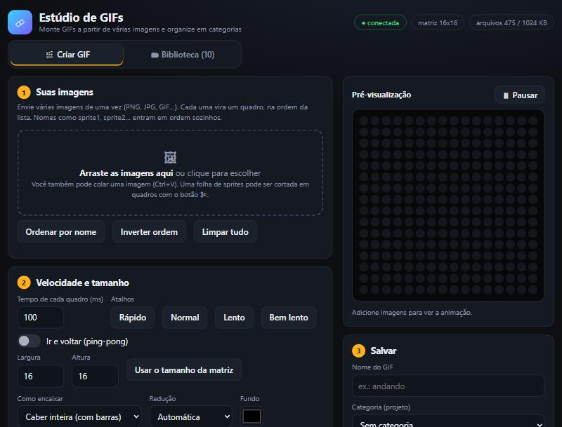

1. **Suas imagens:** arraste ou escolha várias imagens de uma vez (PNG, JPG, GIF…) ou cole uma (Ctrl+V). Cada uma vira um quadro, na ordem da lista (dá para **arrastar os quadros para reordenar**); nomes
   como `sprite1`, `sprite2`… entram em ordem sozinhos. Botões: *Ordenar por nome*, *Inverter ordem*, *Limpar tudo* e **✂ Cortar folha de sprites**
   (colunas, linhas, pular quadros vazios) para transformar uma folha em quadros.
2. **Velocidade e tamanho:** tempo por quadro (ms, ou os atalhos Rápido / Normal / Lento / Bem lento), *ir e voltar* (ping-pong), largura e
   altura (**Usar o tamanho da matriz**), como encaixar (*caber inteira com barras*, *preencher cortando as bordas*, *esticar*), modo de redução (*automática*, *nítida* para pixel
   art, *suave* para fotos) e cor de fundo. Cada quadro pode ter um tempo próprio na caixinha "ms".
3. **Salvar:** nome do GIF, categoria, **Tocar na matriz depois de salvar**, **Gerar e salvar na placa** ou **Baixar no computador**.
   Uma **pré-visualização ao vivo** (com Pausar) mostra a animação no tamanho da matriz. Aparece um aviso acima de 318 pixels por quadro, o limite do
   decodificador da placa.

### Aba 🗂 Biblioteca

- Uma grade dos GIFs da placa com miniaturas animadas, nome, tamanho e a categoria de cada um; **caixa de busca** e lista de **ordenação** (por nome ou por tamanho).
- **Categorias** ao lado: *Todos*, *Sem categoria* e as suas (nome e cor, com contagem). Crie, renomeie ou apague uma categoria (os
  GIFs dela não são apagados, vão para "Sem categoria"). **Arraste um GIF para uma categoria** para movê-lo. As categorias ficam em
  `gifstudio.json` e também são usadas pelo seletor de GIF da ferramenta de Regras MQTT.
- O menu de cada GIF: **Renomear**, **Baixar**, **Usar no relógio** (adiciona como tela extra da ferramenta de relógio), **Mover para** uma categoria (ou uma nova) e **Apagar**.
- Seleção múltipla para mover ou apagar vários GIFs de uma vez, e **↻ Atualizar**.
- (Sem print: a biblioteca mostra as suas próprias imagens.)

## Ferramenta 3: Regras MQTT

`http://IP-DA-PLACA/mqttrules.htm`. Escreve o arquivo de regras usado pelo usermod `mqtt_rules` (veja abaixo). Chips do topo: placa conectada,
**MQTT conectado ao broker**, e quantas regras há na placa e quantas já dispararam. A barra de baixo mostra se há alterações não salvas e tem o botão
**Salvar regras na placa**. As regras são verificadas enquanto você digita (os erros aparecem nessa barra).

### Aba 🔌 Conexão

1. **O que é isso?** Uma explicação curta de MQTT e brokers.
2. **Broker:** endereço (use o **IP**), porta, usuário (se tiver) e o **nome desta placa no broker** (client id). Atalhos preenchem um
   broker público (`broker.hivemq.com`, `test.mosquitto.org`); aparece um **aviso vermelho** quando um broker público está selecionado.
3. **Tópico:** o tópico-base da placa (`wled/...`); **Gerar tópico único** cria um aleatório. Uma chave guarda (retém) as mensagens de estado no broker.
4. **Gravar na placa:** **Gravar conexão e reiniciar a placa** (antes é salvo um backup da configuração antiga).
   Um aviso lembra que o MQTT usa uns 3 a 5 KB da memória da placa.

### Aba 📥 Quando chegar mensagem (mensagem → ação)

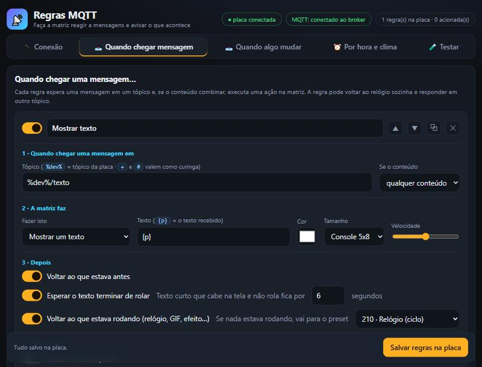

Cada regra tem uma chave liga/desliga, um nome e botões para subir, descer, duplicar e apagar. Seções:
1. **Quando chegar uma mensagem em:** o tópico (`%dev%` = o tópico da placa; `+` e `#` são curingas) e uma condição sobre o conteúdo: *qualquer*, *igual a*,
   *contiver*, *maior que*, *menor que*, *entre a,b*.
2. **A matriz faz:** *Mostrar um texto* (`{p}` = o texto recebido; cor, tamanho, velocidade), *Tocar um GIF* (fixo, ou o nome vem na mensagem), *Mostrar um efeito do WLED*
   (qualquer efeito 2D ou de fita, com os próprios controles, cores e paleta), *Aplicar um preset* (fixo ou o número vem na mensagem), *Mudar o brilho*,
   *Ligar / desligar / alternar*, *Comando JSON* (avançado, com `{p}` e `{n}`) ou *Nada (só responder)*.
3. **Depois:** *Voltar ao que estava antes*, com duas opções: **esperar o texto terminar de rolar** (um texto curto que cabe na matriz fica por N
   segundos) e **voltar ao que estava rodando** (relógio, GIF ou efeito), com um preset de reserva quando nada estava rodando.
4. **Responder:** opcionalmente publica uma mensagem (tópico e conteúdo com `{p}`).

**Seletor de GIF:** quando a ação é um GIF, aparecem um **filtro por categoria** (com contagem) e uma grade de **miniaturas animadas**, além de um **preview** grande do
GIF escolhido com o tamanho e a categoria:

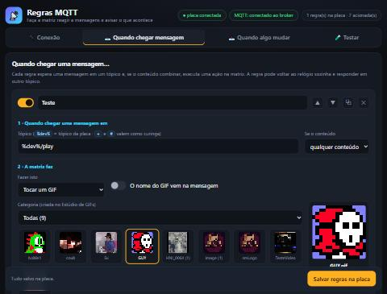

O menu **✨ Exemplos prontos** adiciona regras como: mostrar o texto recebido, tocar um GIF pelo nome, brilho pelo MQTT, ligar/desligar, aplicar um preset pelo número,
avisar quando o preset mudar e avisar ao ligar/desligar.

### Aba 📤 Quando algo mudar (estado → mensagem)

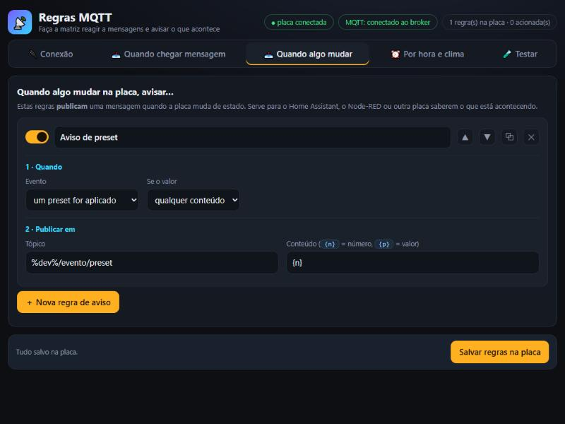

Regras que **publicam** quando a placa muda de estado, para o Home Assistant, o Node-RED ou outra placa saberem o que está acontecendo:
- **Evento:** um preset é aplicado, a matriz liga ou desliga, ou o brilho muda; condição opcional sobre o valor.
- **Publicar em:** tópico e conteúdo (`{n}` = número, `{p}` = on/off ou valor).

### Aba ⏰ Por hora e clima

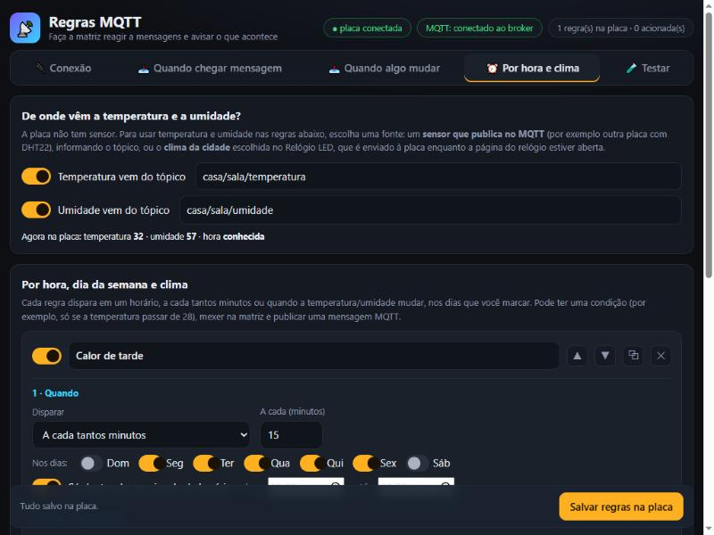

**De onde vêm a temperatura e a umidade.** A placa não tem sensor. Ligue um tópico para cada valor (um sensor, por exemplo outra placa com DHT22, que
publica um número) ou use o clima da cidade escolhida na ferramenta de relógio (só enquanto aquela página estiver aberta). A linha "Agora na placa" mostra os valores atuais
e se a hora é conhecida.

**As regras** disparam:
- **Em um horário**, **a cada N minutos** (opcionalmente só dentro de uma janela de horário, que pode passar da meia-noite) ou **quando a temperatura/umidade mudar**;
- nos **dias da semana** que você marcar (Dom a Sáb);
- opcionalmente **só se** a temperatura ou a umidade for maior que / menor que / igual a / estiver entre valores;
- fazendo uma **ação na matriz** (as mesmas ações acima, com as opções de *voltar*) e/ou **publicando uma mensagem MQTT** cujo conteúdo pode usar `{hm}` (hora),
  `{dw}` (dia da semana, 0 = domingo), `{t}` (temperatura) e `{h}` (umidade).

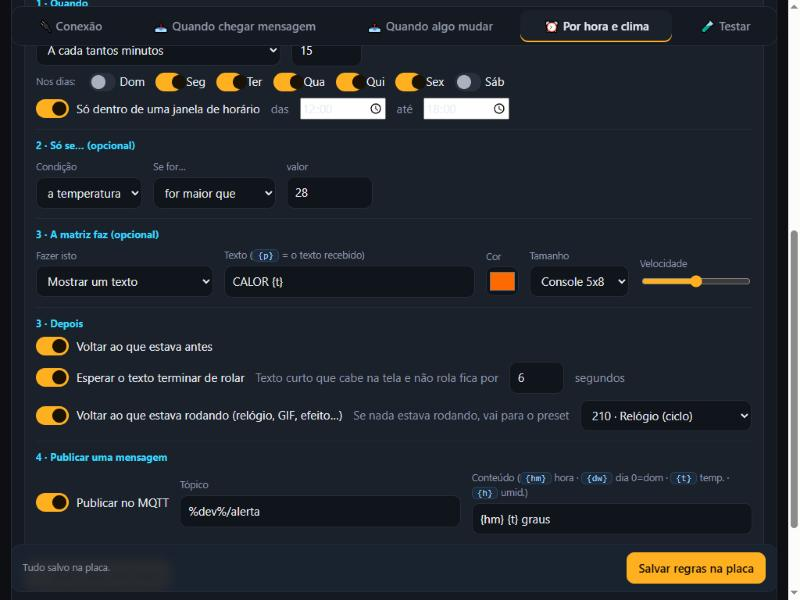

Uma regra disparada por valor dispara quando a condição fica verdadeira e só dispara de novo depois que ela voltar a ser falsa, então não repete a cada leitura.

### Aba 🧪 Testar

Um painel de teste: envie uma **mensagem simulada** (tópico e conteúdo) para a placa sem precisar de broker e leia o **log** da placa com os últimos eventos (regras
disparadas, mensagens recebidas, erros). Também mostra o comando exato para publicar de outro cliente. (Sem print: ele mostra o tópico da placa.)

## Ferramenta 4: Pixel Estúdio (pixel art, sprites, GIF e espelho de tela)

Um editor de pixel art no estilo do *Pixel Paint* do próprio WLED, mas completo: tem **quadros**, **biblioteca de sprites**, salva **GIFs** na placa e
**espelha a tela do computador** na matriz. Abra `http://IP-DA-PLACA/pixelstudio.htm`. A tela de desenho começa com o tamanho da matriz (16x16) e pode ser mudada (1 a 64).
Tudo o que você desenha é salvo sozinho no navegador, então fechar a aba não perde o trabalho.

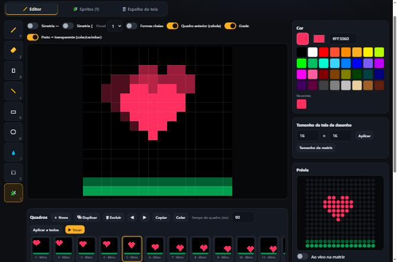

### Aba ✏️ Editor

- **Ferramentas** (barra da esquerda, ou a tecla entre colchetes): lápis `P`, borracha `E`, balde `B` (Shift troca todos os pixels daquela cor), linha `L`, retângulo `R`,
  elipse `O`, conta-gotas `I`, seleção e mover `S`, carimbo de sprite `T`. O botão direito apaga; Alt+clique pega uma cor.
- **Opções**: pincel de 1 a 4 pixels, **simetria** horizontal e vertical, formas cheias, **cebola** (o quadro anterior ao fundo), grade
  e "preto = transparente" para colar e carimbar.
- **Seleção**: desenhe um retângulo, arraste para mover (com Ctrl copia), as setas empurram, `Ctrl+C`, `Ctrl+X`, `Ctrl+V`, `Del`; `Enter` posiciona.
- **Cor**: seletor de cor, campo hex, 32 cores prontas e as 16 mais recentes.
- **Desfazer / refazer**: `Ctrl+Z` / `Ctrl+Y`, 60 passos.
- **Quadros** (linha do tempo abaixo do desenho): novo, duplicar, excluir, mover (botões ou arrastando), copiar e colar quadro, tempo de cada quadro em ms
  ou um valor para todos, **tocar** na prévia (`Espaço`), ida e volta opcional.
- **Quadro atual**: espelhar, virar, girar 90° (só em tela quadrada), inverter cores, limpar, deslocar com volta pelo outro lado; a chave "em todos os quadros" aplica em todos.
- **Prévia** em estilo LED e **Ao vivo na matriz**: o que você desenha aparece na matriz de verdade na hora, e tocar a animação toca lá também, sem salvar arquivo.
- **Salvar GIF**: nome, "ping-pong", "tocar na matriz depois" e **Gerar e salvar na placa** (envia o `.gif`, pergunta antes de substituir). Também **baixar o GIF**,
  **salvar o projeto** (`.pxs.json`) e **abrir / importar**.
- **Importar**: imagens (também coladas com `Ctrl+V`), GIFs animados (cada quadro vira um quadro) e folhas de sprites (cortadas em quadros ou em sprites), e projetos `.pxs.json`.
- Uma tela com mais de 318 pixels por quadro (por exemplo 20x20) é permitida, mas a placa não toca esse GIF; a ferramenta avisa.

### Aba 🧩 Sprites

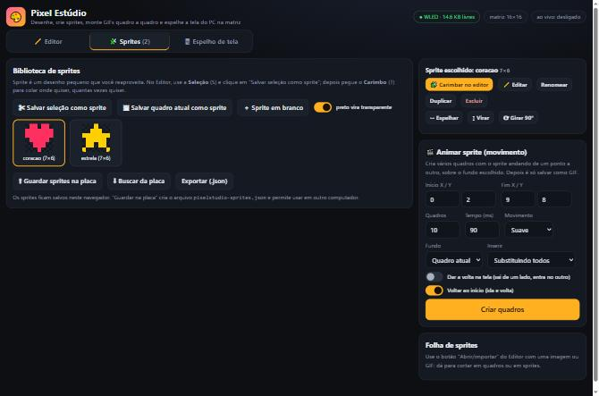

Sprite é um desenho pequeno que você reaproveita. Selecione uma área no editor e use **Salvar seleção como sprite** (ou salve o quadro inteiro, ou comece um em branco).
A biblioteca fica no navegador; **Guardar sprites na placa** grava o `pixelstudio-sprites.json` para outro computador buscar, e a lista pode ser exportada em JSON.

- **Carimbar no editor** troca para o carimbo: clique para colocar o sprite, quantas vezes quiser.
- **Editar** abre o sprite em um quadro novo; salve de novo com o mesmo nome para atualizar.
- Renomear, duplicar, excluir, espelhar, girar 90°.
- **Animar sprite (movimento)** cria quadros de um sprite indo de um ponto a outro: X/Y de início e fim, número de quadros, tempo, tipo de movimento (constante, acelera,
  freia, suave), fundo (o quadro atual ou preto), inserir depois do quadro atual ou substituir todos, "dar a volta na tela" e "voltar ao início" (ida e volta).
  O resultado são quadros normais, prontos para editar e salvar como GIF.

### Aba 🖥 Espelho de tela

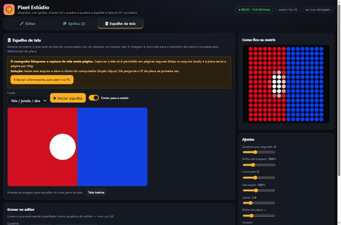

Mostra na matriz, em tempo real, o que está na tela do computador (a tela inteira, uma janela ou uma aba do navegador) ou a câmera. A imagem acima mostra o aviso que a
página dá quando é aberta pela placa, com uma imagem de teste sintética.

- **Como funciona**: o navegador captura o vídeo, recorta a parte escolhida (arraste sobre a imagem; "Tela inteira" desfaz), encaixa no tamanho da matriz tirando a média
  dos pixels, aplica os ajustes e envia só os pixels que mudaram pelo WebSocket, em mensagens pequenas (o ESP8266 aceita uns 528 bytes por mensagem).
  Ele espera a placa responder antes de mandar mais.
- **Ajustes**: quadros por segundo (1 a 20, padrão 8), brilho da imagem, contraste, saturação, gama, espelhar na horizontal / vertical, encaixe (esticar, imagem inteira, preencher)
  e o **brilho da placa**.
- **Gravar no editor**: grava N quadros do espelho como quadros do editor (vira um GIF), ou captura um único quadro.
- **Iniciar e parar**: o espelho assume a matriz inteira como um segmento. Ao parar, a ferramenta devolve a placa como estava (os segmentos, o preset ou a playlist de antes).
  Se o relógio estava sendo desenhado pela página do Relógio LED, ele volta quando essa página enviar de novo.
- **Capturar a tela exige uma página segura.** A placa serve as páginas em `http` simples, e os navegadores só permitem capturar a tela em `https` ou em arquivo local. Por isso a página mostra o
  botão **Baixar a ferramenta para abrir no PC**: salve o `pixelstudio.html`, dê dois cliques e digite o IP da placa na primeira vez (ou abra como `pixelstudio.html?ip=192.168.0.170`).
  O resto (desenhar, salvar, ao vivo) funciona nas duas páginas.

### O que foi verificado

- Na placa: ferramentas de desenho, desfazer, seleção, criação de sprite, o gerador de movimento (8 quadros), criação do GIF (o GIF gerado foi lido de volta: 16x16, 8 quadros), salvar na
  placa e tocar.
- Edição ao vivo: a matriz mostrou exatamente os pixels desenhados no editor (comparado pixel a pixel pela visualização ao vivo).
- Espelho: testado com um vídeo sintético (metades vermelha e azul e um círculo branco em movimento) no lugar da tela. A matriz reproduziu a imagem a uns 8 quadros por segundo, com cerca de 13,7 KB de
  heap livre durante o teste, e ao parar voltou o layout do relógio com dois segmentos.
- De outra origem (`localhost` com `?ip=`) a página alcançou a placa (informações, WebSocket, envio de arquivo e a biblioteca de GIFs), que é o que a cópia baixada faz.
- **Não verificado**: capturar uma tela ou janela de verdade (o navegador pede permissão à pessoa, e um script não consegue dar), a câmera, a cópia baixada aberta como página `file://` e telas de toque.

## Ferramenta 5: Jogos na Matriz

Dez jogos para a matriz 16x16, jogados no PC ou no celular: abra `http://IP-DA-PLACA/jogos.htm`. O jogo roda no navegador, que desenha na tela e envia para a
matriz. Sem a placa ele continua funcionando só na tela.

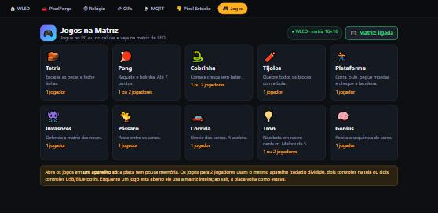

| Jogo | Jogadores | Como é |
|---|---|---|
| Tetris | 1 | sete peças, sombra da peça, próxima peça, níveis |
| Pong | 1 ou 2 | contra a placa (3 dificuldades) ou um amigo, até 7; raquetes nas laterais ou em cima/embaixo |
| Cobrinha | 1 ou 2 | paredes que atravessam ou matam; duas cobras no modo de 2 |
| Tijolos | 1 | quatro desenhos de blocos, blocos de duas batidas a partir da fase 2, 3 vidas |
| Plataforma | 1 | três fases com rolagem, moedas, espinhos, inimigos que dá para pisar, plataformas que atravessam por baixo |
| Invasores | 1 | ondas de naves, escudos, bombas |
| Pássaro | 1 | voar entre os canos |
| Corrida | 1 | quatro faixas, turbo |
| Tron | 1 ou 2 | contra a placa ou um amigo, melhor de 5 |
| Genius | 1 | repetir a sequência de cores |

### Controles

| | Teclado do PC | Celular / tablet | Controle (USB ou Bluetooth) |
|---|---|---|---|
| 1 jogador | setas ou WASD, `espaço` = A, `X` = B | direcional e botões na tela; arrastar na tela no Pong, Tijolos e Invasores; tocar no Pássaro e no Genius | direcional ou analógico, botões A / B, Start pausa |
| 2 jogadores | J1 `WASD` + `espaço`; J2 setas + `Enter` | um controle para cada jogador no mesmo aparelho; no Pong com raquetes em cima/embaixo o segundo controle fica virado para o outro jogador | um controle para cada um |

`P` pausa, `R` reinicia, `Esc` volta ao menu. A barra tem pausa, reiniciar, som, matriz ligada/desligada, tela cheia e, no PC, um botão que mostra os controles na tela.

| Celular deitado (toque) | PC |
|---|---|
| 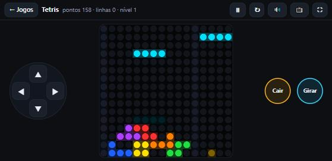 | 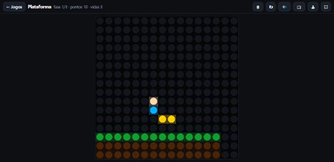 |

### A tela do aparelho

O jogo é feito para ser visto **na matriz**, então a prévia no aparelho fica **escondida**: a tela mostra o placar, uma linha de situação e controles grandes.
O botão 👁 mostra a prévia (a escolha fica guardada). Ela aparece sozinha quando não há placa, quando o botão da matriz está desligado ou quando não foi possível usar a matriz.
Com a prévia escondida ainda dá para arrastar no Pong, no Tijolos e no Invasores, na área livre acima dos botões.

### Dois jogadores, em um ou dois aparelhos

No Pong, na Cobrinha e no Tron escolha **2** jogadores e depois **quem você é**: *Jogador 1*, *Jogador 2* ou *Os dois neste aparelho* (teclado dividido, dois controles na tela, dois joysticks).

Para usar dois celulares (ou um PC e um celular):

1. No primeiro aparelho escolha o jogo, 2 jogadores e *Jogador 1* (ou 2). Ele roda o jogo e desenha na matriz.
2. Abra o `jogos.htm` no segundo aparelho. Aparece a caixa **"Pong em andamento, quem é você?"**. Escolha o jogador livre.
3. O segundo aparelho mostra **só o controle daquele jogador**. Qualquer um dos dois pode começar, e o segundo pode pausar.

Se o segundo aparelho sair (fechar, ou ficar 4,5 s sem sinal), o jogo pausa e a vaga fica livre. No Pong com raquetes em cima e embaixo, o segundo controle tem um botão
para inverter esquerda e direita, para quem está sentado do outro lado da matriz.

| Entrando em um jogo em andamento | O controle do segundo jogador |
|---|---|
|  | 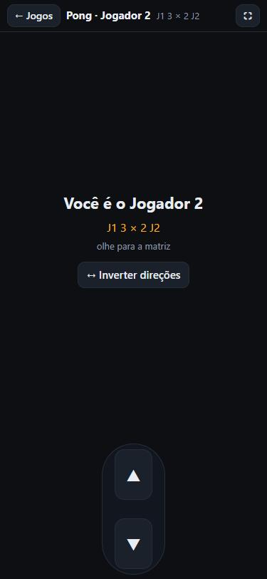 |

Isso precisa do usermod `game_relay` no firmware ([usermods/game_relay](usermods/game_relay/readme.md)): a placa copia as mensagens pequenas `{"gm":…}` entre as páginas
abertas. Sem ele o resto funciona, e os dois jogadores dividem um aparelho.

### O que saber

- O jogo roda em **um aparelho**; o segundo celular só envia os botões. Cada página aberta usa memória da placa, então não deixe abas sobrando. Enquanto um jogo está aberto ele usa a matriz inteira; ao voltar (ou sair da página) a placa volta aos segmentos, preset ou playlist de antes.
- A matriz é atualizada umas 6 a 14 vezes por segundo (conforme a imagem muda, até esse ritmo), medido na placa. A tela do aparelho é mais suave que a matriz.
- Os recordes ficam no navegador.
- Os jogos foram feitos para 16x16; em outros tamanhos a imagem é centralizada e cortada.

### O que foi verificado

- Testes por script (`node ferramentas/jogos/test/test_games.js`): centenas de partidas aleatórias em todas as combinações de opções sem erro; cada fase da plataforma dá para terminar
  (uma busca com a física real do jogo chega na bandeira); jogadores automáticos limpam blocos, passam pelos canos e repetem sequências do Genius; remoção de linhas, fim de jogo e vencedores funcionam.
- No navegador, com a placa: jogo pelo teclado, toques simulados (andar e pular com dois dedos, dois controles no Pong, arrastar), layouts de celular em pé e deitado,
  a imagem na matriz, a restauração ao sair da página e 3,4 minutos de jogo contínuo sem reiniciar (menor heap livre 10,8 KB).
- Dois aparelhos: o repasse entregou 100 de 100 mensagens (mediana 15 ms, 95 % abaixo de 39 ms) sem alterar o estado da placa. Com um jogo desenhando e um segundo cliente
  (um script que carrega a página e manda comandos quatro vezes por segundo) por 2 minutos: nenhum reinício, o comando voltou em 17 ms (mediana), menor heap livre de 10 a 11 KB,
  e a matriz recebeu uns 10 quadros por segundo de 13 mudanças. Entrar, controlar, recusar vaga ocupada, perder a conexão e sair foram testados com uma segunda página simulada.
- A placa reiniciou uma vez durante um teste de rede anterior, sem intervalo entre os envios; a causa não foi identificada e não se repetiu.
- **Não verificado**: dois celulares de verdade, dedos de verdade, um controle físico, o som e a tela cheia no iOS.

## Usermod de regras MQTT

`usermods/mqtt_rules` guarda as regras em `/mqttrules.jsonl` (um objeto JSON por linha, até 760 caracteres,
até 10 tópicos assinados). As regras são lidas da flash quando preciso, então quase não usam RAM.
O formato das regras, os marcadores (`%dev%`, `{p}`, `{n}`, `{t}`, `{h}`, `{hm}`, `{dw}`), as opções `b` (voltar ao anterior) e `w`
(esperar o texto), as regras por hora e de fonte de valor e a API JSON estão em [usermods/mqtt_rules/readme.md](usermods/mqtt_rules/readme.md).

Como funciona o "voltar ao anterior": antes da primeira ação temporária o usermod guarda a playlist ou o
preset em execução e, quando a ação termina, aplica de novo. O "esperar o texto" acompanha a posição de
rolagem do efeito Scrolling Text e termina quando ela volta a zero, com limite de segurança de 3 minutos.

Verificado na placa: um texto longo voltou depois de rolar inteiro (cerca de 18 s, e não os 3 s do
temporizador), um texto que cabe voltou no tempo configurado, a playlist do relógio foi restaurada todas as vezes, uma regra de hora disparou no minuto escolhido e não em um dia da semana excluído,
as condições de temperatura bloquearam e liberaram corretamente, e as regras disparadas por valor dispararam uma vez por cruzamento.

## Arquivos e API usados na placa

| Na placa (LittleFS) | O que é |
|---|---|
| `relogio.htm.gz`, `gifstudio.htm.gz`, `mqttrules.htm.gz`, `pixelstudio.htm.gz`, `jogos.htm.gz` | as cinco páginas das ferramentas |
| `pftools.json` | a lista mostrada no PixelForge → *Other tools* |
| `relogio-config.json` | estado da ferramenta de relógio |
| `relogio-cfg-backup.json`, `relogio-presets-backup.json`, `mqtt-cfg-backup.json` | backups feitos antes de as ferramentas mudarem a configuração |
| `gifstudio.json` | categorias de GIF e a categoria de cada GIF |
| `mqttrules.jsonl` | as regras que o usermod executa |
| `mqttrules-ui.json` | as regras como aparecem na ferramenta (e os tópicos dos sensores) |
| `pixelstudio-sprites.json` | sprites guardados pelo Pixel Estúdio (opcional) |
| `*.gif` | os seus GIFs |

As ferramentas usam só a API normal do WLED: `/json/state`, `/json/info`, `/json/effects`, `/json/fxdata`, `/json/palettes`, `/presets.json`,
`/cfg.json` (enviá-lo restaura a configuração e reinicia), `/edit?list=/`, `/edit?func=delete`, `/upload`, o live view por WebSocket e, com
`GIF_LOG`, `/giflog`. O usermod acrescenta o objeto `mqttr` ao `/json/state` (`reload`, `test`, `set`) e ao `/json/info`.

## Compilar e instalar

```powershell
git clone https://github.com/wled/WLED.git
cd WLED
git checkout 356d5e71c2107fac9475ff488c48d89ac2d382e9
git apply ..\wled-esp8266-matrix\patches\0001-wled-esp8266-gif.patch
Copy-Item -Recurse ..\wled-esp8266-matrix\lowram_libs .
Copy-Item -Recurse ..\wled-esp8266-matrix\usermods\mqtt_rules usermods\
Copy-Item -Recurse ..\wled-esp8266-matrix\usermods\game_relay usermods\
Copy-Item ..\wled-esp8266-matrix\platformio_override.ini .
npm ci; npm run build
pio run -e d1_r2_gif
```

O `.bin` sai em `build_output/release/`. Grave com `pio run -e d1_r2_gif -t upload` (USB) ou abra
`http://IP-DA-PLACA/update` (OTA).

Instale as ferramentas (arquivos gzip) e registre-as:

```powershell
curl.exe -F "data=@ferramentas/relogio/relogio.htm.gz;filename=relogio.htm.gz"   http://IP-DA-PLACA/upload
curl.exe -F "data=@ferramentas/gifstudio/gifstudio.htm.gz;filename=gifstudio.htm.gz" http://IP-DA-PLACA/upload
curl.exe -F "data=@ferramentas/mqtt/mqttrules.htm.gz;filename=mqttrules.htm.gz"   http://IP-DA-PLACA/upload
```

Depois acrescente uma entrada por ferramenta (`id`, `name`, `file`, `desc`) no `pftools.json` da placa para
que apareça no PixelForge. As páginas também abrem direto em `http://IP-DA-PLACA/relogio.htm`, `/gifstudio.htm`
e `/mqttrules.htm`. Para mudar uma ferramenta, edite o `*.src.htm` e rode o `build.py` dela.

Dicas aprendidas na prática:
- OTA: feche as outras abas do navegador que apontam para a placa e use `curl -H "Expect:"`. Se a placa responder ao ping mas não ao HTTP depois de uma gravação, desligue e ligue e confira se a
  versão mudou de verdade (o objeto `mqttr` em `/json/info` tem os campos mais novos).
- O USB pode cair com a matriz ligada (consumo de corrente); alimente a matriz separadamente ou use OTA.
- Use o ambiente `d1_r2_gif_log` e leia `http://IP-DA-PLACA/giflog` para ver o que o carregador de GIF está fazendo.
- Confira o heap livre em `http://IP-DA-PLACA/json/info` (`freeheap`) ao testar recursos novos.

## Limitações

**GIF**
- Quadros de até **318 pixels** no build padrão (16x16, 32x8). GIFs maiores mostram erro. Subir `GIF_CODE_LIMIT`
  para 1024 permite 766 pixels (32x16), usando uns 2 KB a mais de RAM.
- O efeito Imagem precisa de `ix` (blur) em 0.
- A troca de imagem pode esperar até uns 10 s se o heap estiver curto (por exemplo com muitas páginas abertas).

**Memória**
- Enquanto um GIF toca, o heap livre é de só uns 9 KB: **mantenha uma aba aberta** e evite a pré-visualização ao vivo (veja a [seção de memória](#o-esp8266-e-a-memória-dele)).
- O WLED recusa alocações abaixo de 9 KB; evite presets muito grandes ou muitos segmentos.
- Com o MQTT ligado, GIFs grandes podem não tocar enquanto o painel web está ocupado.
- A flash está em 86 %. Para abrir espaço é preciso remover recursos, não acrescentar.
- Para sair de um travamento: desligue e ligue a placa.

**Rede**
- Sem TLS no ESP8266 neste build, então não há brokers `mqtts://` (HiveMQ Cloud e a maioria dos serviços hospedados).
- A placa não resolve nomes de forma confiável. Use **IPs** para o broker MQTT e para o servidor NTP.
- Brokers públicos exigem um tópico que ninguém mais use. Um cliente como o MQTT Explorer precisa estar conectado no **mesmo broker** da placa e, no
  `broker.hivemq.com`, deve assinar tópicos específicos (por exemplo `wled/<seu-topico>/#`): o curinga `#` em tudo pode não entregar nada.

**Regras MQTT**
- 10 tópicos, 4 mensagens na fila, 760 caracteres por regra, texto de até 40 caracteres.
- As regras leem o arquivo a cada mensagem, então taxas muito altas de mensagens não são o objetivo.
- Regras de evento cobrem só mudança de preset, energia e brilho.
- "Esperar o texto" vale para o efeito Scrolling Text no segmento 0.
- A placa não tem sensor de temperatura/umidade. Os valores vêm de um tópico MQTT ou do clima da ferramenta de relógio, que
  só é enviado enquanto a página do relógio estiver aberta (e se perde ao reiniciar). Se as duas fontes forem usadas, vale a última a escrever.
- As regras de hora só funcionam depois que a placa tem a hora (NTP) e usam o fuso configurado nela. Um fuso errado desloca todas as regras.
- As regras disparadas por valor guardam o estado "armado" só para as 32 primeiras regras; o log mostra os últimos 6 eventos.

**Ferramentas**
- Feitas para uma matriz 16x16 de um segmento. Outros tamanhos funcionam em princípio, mas não foram testados.
- O PixelForge pode reescrever o `pftools.json` e apagar as cinco entradas personalizadas; acrescente-as de novo se acontecer.
- As ferramentas só definem o preset de boot se você marcar na aba *Placa e hora*, então o relógio não inicia sozinho depois de reiniciar até que
  você defina um preset de boot.
- A interface está em português do Brasil.
- **Pixel Estúdio**: o modo ao vivo e o espelho usam um WebSocket e pegam a matriz inteira como um segmento, então a memória livre cai uns 1 a 3 KB enquanto rodam; mantenha uma aba só.
- O espelho envia pixel a pixel pela API JSON, então roda a uns 8 quadros por segundo (dá para escolher até 20, mas a placa pode não acompanhar). Não é transmissão de vídeo: para
  vídeo fluido use um emissor DDP/E1.31, o que uma página web não consegue fazer (não tem UDP).
- Capturar a tela só funciona em página segura (veja [a aba do espelho](#aba--espelho-de-tela)): baixe a página e abra pelo computador.
- Os sprites e o projeto salvo automaticamente ficam no armazenamento do navegador (por navegador e por endereço); use *Guardar sprites na placa* ou *Salvar projeto* para levar de um lugar a outro.

## Segurança

- Um broker MQTT público permite que qualquer pessoa que descubra seu tópico mande texto para a matriz. Use o
  tópico único gerado, faça testes curtos e desligue o MQTT depois. Para uso de verdade, rode seu próprio broker
  (Mosquitto, Home Assistant) na rede local e configure usuário e senha.
- Nunca publique senhas ou tokens digitados em tutoriais ou prints; troque-os se vazarem.
- O arquivo de regras pode executar qualquer comando JSON do WLED. Só deixe clientes de confiança publicarem nos tópicos assinados.
- Os prints deste repositório têm o nome da cidade escondido; o tópico da placa e as configurações do broker não aparecem.

## O que não foi feito

- Redesenho para enviar quadros brutos (empurrar pixels direto).
- TLS no MQTT e correção da resolução de nomes (DNS).
- Iniciar o relógio automaticamente ao ligar.
- Testes reais do espelho com captura de tela e câmera (só um vídeo sintético foi usado) e um modo de vídeo fluido com DDP/E1.31.
- Um decodificador de GIF menor: ainda dá para economizar algumas centenas de bytes nos buffers, mas não os 3 KB ou mais necessários para um GIF conviver com várias abas do navegador.

## Estrutura do repositório

```
patches/                 diff contra o WLED (commit em WLED_BASE_COMMIT.txt)
lowram_libs/             AnimatedGIF (tabelas reduzidas) e GifDecoder (todas as arquiteturas)
usermods/mqtt_rules/     motor de regras + readme
usermods/game_relay/     repasse de mensagens dos jogos em dois aparelhos + readme
ferramentas/             ferramentas relogio, gifstudio, mqtt, pixelstudio, jogos (fonte, script de build, gzip); nav.snip.html é a barra do topo comum
platformio_override.ini  ambientes de compilação para a D1 R2
docs/img/                prints e gráficos de memória
```

O WLED usa licença MIT; a AnimatedGIF usa Apache-2.0. Confira a licença de cada projeto de origem antes de reutilizar o código.
